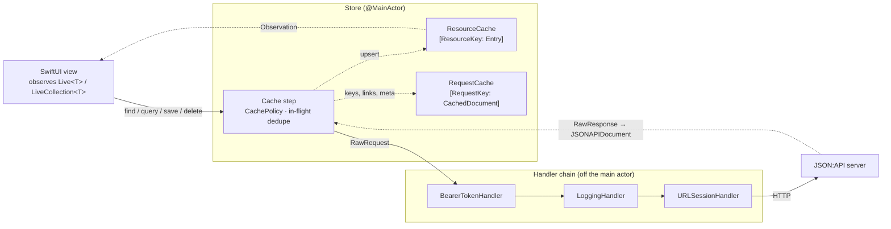

# IonKit Architecture Design

2026-10-15 · Daniel Jilg

> This file is the canonical source of truth for IonKit's design. It started as a Claude Docs document on
> 2026-10-15 and was moved into the repository, with the revisions listed under
> [Implementation notes](#implementation-notes-2026-10-15), after v0.1–v0.3 landed; v1.1 (the v1.x ergonomics) followed
> on 2026-10-16, v1.2 (two fixes found in the Village app), v1.3 (the request outcome observer, `batch` and
> DELETE 404 as success), v1.4 (the cache snapshot), v1.5 (typed throws on Swift 6.2), v1.6 (LRU eviction) and v1.7
> (observable `related`) on 2026-10-17. Consumers of the library start at
> [Current state of the code](#current-state-of-the-code-v17-2026-10-17). Change the code and this file in the same
> pull request.

## Purpose and goals

IonKit is a Swift package that lets a SwiftUI app display and edit structs that live behind any JSON:API server, with one live-updating instance per resource and an explicit draft/save cycle for edits. The Village app (a Vapor 5 JSON:API server, one user per graph, online-only writes) is its first consumer and the source of its fixtures, but nothing in the package is Village-specific: the target is JSON:API 1.1 as a client, with the spec's optional members optional in IonKit too.

**Goals for v1**

- Define a resource as a plain `Codable` struct plus a resource type and a path; no runtime schema registry, no code generation.
- Fetch one resource or a collection, with `include`, and get back instances that update whenever any later response touches the same resource.
- Edit through a `Draft<T>` copy, save with a PATCH that carries only changed fields, create with POST, delete with DELETE; the live instances and open collections update from the response.
- Work against any JSON:API 1.1 server: every top-level and resource-level member is parsed, key casing is configurable, and features the spec leaves optional (`source.pointer`, `links.next`, `Cache-Control`) improve behavior when present and break nothing when absent.
- Cache in RAM with stale-while-revalidate defaults (serve cached, refetch in the background) that honor the server's cache headers.
- Compile on macOS 15, iOS 18 and Linux (Swift 6.2 or later, Foundation only, no third-party dependencies).
- Stay small: the v1 core is one target of roughly 2,000–3,000 lines that two people, or an agent with this document, can hold in their head.

**Non-goals for v1** (some return in later milestones, see Development milestones)

- Offline writes, optimistic UI, conflict resolution.
- Relationship inverses; polymorphic relationships (typed, live-resolving relationships arrived in v1.7 as `related`; see Relationships and includes).
- Persistent cache on disk (arrived in v1.4 as a snapshot file; see Cache).
- Sparse fieldsets and field-level merging of partial resources.
- Code generation or macros for resource definitions.
- Multi-tenant or admin-only resource types; v1 only needs to not block them.
- Any transport other than HTTP(S) via `URLSession`.

## WarpDrive (Polaris mode) and its Swift counterparts

IonKit borrows WarpDrive's layering (request chain → cache → live resources), not its JavaScript mechanics. WarpDrive's Polaris mode is still marked preview in its v5 line and becomes the default in v6; the concepts below are stable, the API details are from the 5.10 alpha source ([polaris-mode guide](https://warp-drive.io/guides/the-manual/schemas/resources/polaris-mode), [caching guide](https://warp-drive.io/guides/the-manual/caching/index), [requests guide](https://warp-drive.io/guides/the-manual/requests/index)).

| WarpDrive concept | What it does there | IonKit equivalent |
| --- | --- | --- |
| `Store` | Coordinator owning request manager, cache, schema service, notifications | `Store` — one `@MainActor` object per API/session, owns cache + client |
| `RequestManager` + handlers | Chain of responsibility; each handler gets `(context, next)`; `Fetch` last | `RequestHandler` protocol chain ending in `URLSessionHandler`; auth and logging are handlers |
| `CacheHandler` | First in chain; cache hit vs fetch vs background refetch; dedupes in-flight requests; writes every response into the cache | The cache step inside the store, above the handler chain, with the same decision order; handlers never see cache hits |
| `JSONAPICache` | Documents stored by `RequestKey` (replace), resources by `ResourceKey` (upsert per field), local edits as a diff over remote state | `ResourceCache`: identity map `[ResourceKey: Entry]` (raw resource object + lazily decoded `Live<T>`) + `[RequestKey: CachedDocument]`; local edits live in `Draft`, not in the cache (v1) |
| `SchemaService` + `ResourceSchema` fields (`field`, `derived`, `belongsTo`/`hasMany` in LinksMode, `schema-object`, `alias`, `@local`) | Runtime registry of field definitions driving a Proxy | Swift types replace the registry: a `Codable` struct conforming to `Resource` (`static resourceType`, `id`, attributes, `ToOne`/`ToMany` relationships); derived = computed properties; transformations = `Codable` |
| `ReactiveResource` (immutable Proxy) | Live, read-only instance re-rendering on remote changes | `Live<T>`: `@Observable` final class holding the current `T` value, updated by cache upserts |
| `ReactiveDocument` (`data`, `included`, `links`, `meta`, `errors`) + `next()`/`prev()` | Hydrated response; pagination follows links | `LiveCollection<T>` observable with `reload()` / `loadMore()` over `links` |
| `checkout()` → editable copy, `op: updateRecord` + `records:` → `didCommit` | Local edits isolated from the live instance; server response becomes new remote state | `Draft<T>` (plain mutable struct copy) + `store.save(&draft)`; response upserted into cache, which updates every `Live<T>` |
| `store.createRecord` | New record with client `lid` before server `id` | `Draft(new:)` with a client-local placeholder id that is never sent; the `Live<T>` is created from the server's response |
| Request builders (`findRecord`, `query`, `createRecord`, `updateRecord`, `deleteRecord`) | Plain request descriptions typed with `withReactiveResponse<T>` | `Request<Response>` structs; builders on the store (`store.find(T.self, id:)`, `store.query(T.self, …)`) |
| `cacheOptions` (`key`, `reload`, `backgroundReload`, `types`) | Per-request cache control and invalidation tags | `CacheOptions` struct on `Request`; `types` invalidates cached collection queries after a mutation |
| `DefaultCachePolicy` (hard/soft expiry, honors `Cache-Control`, `Expires`) | Decides stale vs expired per `RequestKey` | `CachePolicy` protocol + `DefaultCachePolicy(soft: 1 min, hard: 24 h)`, honoring `Cache-Control` / `Expires` from v1 |
| `Type` brand (`[Type]: 'user'`) | TypeScript-only inference of resource type string | Not needed — Swift generics carry the type |
| `Future` (Promise + `abort()`, `getStream()`) | Cancellable request | `Task` + `async throws(IonError)`; cancellation via Swift structured concurrency |
| Notifications (`remote` / `local` channels) | Field-level signals | `Observation` framework; the cache assigns `live.value` only when it changed |
| `@warp-drive/ember` `<Request>` / `@warp-drive/react` | Framework bindings with loading/error/content states | SwiftUI: `LoadState` on collections (v1) + the `Fetch` view with loading / content / failed-with-retry (v1.1) |

Three WarpDrive behaviors are worth copying exactly: (1) every response is written to the cache even when the request itself is not cacheable, which is how POST/PATCH/DELETE update live instances; (2) in-flight requests with the same key are deduplicated; (3) a successful create invalidates cached queries tagged with that resource type.

Two things IonKit deliberately does not copy: the runtime schema registry (Swift's type system does that job at compile time) and storing local edits inside the cache as a diff (a `Draft<T>` value is simpler and enough for online-only writes).

## Core architecture

Four layers, one direction of calls and one direction of updates: views call the store, the store runs requests through the handler chain, responses are decoded and upserted into the resource cache, and the cache notifies the live instances that views observe.



Solid arrows are calls; dashed arrows are data flowing back. Everything inside the store runs on the main actor; the handler chain and decoding run off it.

**Data flow of `store.find(Person.self, id: "42")`**

1. The store builds a `Request<JSONAPIDocument>` (`GET /people/42`, `op: .find`, `records: [person/42]`) and derives its `RequestKey` from the URL.
2. Cache step (inside the store, before any handler runs): if a `CachedDocument` exists for the key and the policy says `.fresh`, return the cached `Live<Person>` immediately. If `.stale`, return it and start a background refetch. If `.expired` or absent, or `reload` was requested, fetch and wait. A second caller with the same key while a fetch is in flight awaits the same task.
3. The handler chain runs off the main actor: `BearerTokenHandler` adds the header, `URLSessionHandler` performs the request and returns `RawResponse(status, headers, data)`.
4. Still off the main actor, the codec decodes `data` into a `JSONAPIDocument` (primary data, `included`, `links`, `meta`, `errors`) and decodes the primary resource objects into `Person` values, since the request's type is known. HTTP 4xx/5xx becomes `IonError.http`; a primary object that fails to decode fails the request with `IonError.decoding`.
5. One hop to the main actor: every resource object in `data` and `included` is upserted into the `ResourceCache` by `ResourceKey` as a raw `ResourceObject`; where a typed `Live<T>` already exists for the key it is re-decoded and its `value` updated. Primary objects get their `Live<Person>` now; included objects (`Tag`, `Group`) stay raw until the first typed access (`peek`, `resolve`, `find`), because the store cannot know their Swift type from the wire string alone. The document is stored under its `RequestKey` as a list of `ResourceKey`s plus `links` and `meta`.
6. The store returns the `Live<Person>` for `person/42`. Any view already showing that instance re-renders through Observation.

Writes follow the same path with two extras: before the request the draft's changes are serialized into the body, and after a success the response resource is upserted (so the live instance shows the server's version) and every cached query of the same type is invalidated, which reloads any `LiveCollection<T>` currently alive (see the invalidation rules under Cache). A response that arrives for a request started before the key's last mutation does not overwrite that key.

## Defining resources

A resource is a flat `Codable` struct that conforms to `Resource`; the struct's stored properties are the JSON:API `attributes`, properties typed `ToOne` / `ToMany` are the `relationships`, and `id` is the resource id. There is no schema object to register: the Swift type is the schema.

`swift
public protocol Resource: Codable, Sendable, Equatable {
    /// JSON:API `type`, e.g. "person"
    static var resourceType: String { get }
    /// Collection path relative to the store's base URL. Default: resourceType + "s".
    static var collectionPath: String { get }
    /// Server-assigned id. A new draft carries a client-local placeholder ("local:<uuid>") that is never sent.
    var id: String { get set }
}

struct Person: Resource {
    static let resourceType = "person"
    static let collectionPath = "people"

    var id: String
    var name: String
    var birthday: Date?
    var notes: String = ""
    var tags: ToMany<Tag> = .unloaded     // relationship: ids only in v1
    var group: ToOne<Group> = .unloaded

    // derived values are plain computed properties
    var initials: String { name.split(separator: " ").compactMap(\.first).map(String.init).joined() }
}
`

`ToOne<T>` and `ToMany<T>` are small `Codable` enums. `ToOne`: `.unloaded` (key absent from the payload), `.null` (`"data": null`), `.id("7")`. `ToMany`: `.unloaded` (key absent), `.ids(["7", "9"])` (`"data": []` when empty). Each decodes from a JSON:API relationship object and encodes back to one; encoding `.unloaded` omits the key entirely; `links` and `meta` on a relationship are ignored in v1. For form bindings they expose `ToOne.id: String?` (setting `nil` gives `.null`) and `ToMany.ids: [String]` as get/set properties, so a `Picker` binds to `$draft.value.group.id`. They carry `T` only so that `store.peek(person.value.group)` can return `Live<Group>?` without a cast.

**How the codec maps a struct to the wire format**

| Wire | Struct | Rule |
| --- | --- | --- |
| `type` | `Person.resourceType` | Checked on decode; mismatch is `IonError.decoding` |
| `id` | `id` | Always a `String`; a placeholder `local:…` id is omitted on POST and rejected anywhere else (`IonError.invalidDraft`) |
| `attributes.*` | every other stored property | Decoded by merging `id` and `attributes` into one JSON object and running `JSONDecoder`; keys are used as-is (snake_case servers set a `keyDecodingStrategy` on the store); dates parse ISO 8601 with or without fractional seconds |
| `relationships.*` | `ToOne` / `ToMany` properties | Decode: the keys of the wire `relationships` object are merged into the same JSON object as `{"data": …}` values. Encode: the codec runs a `JSONEncoder` whose `userInfo` carries a key collector; `ToOne`/`ToMany.encode(to:)` record their coding path there, and the codec moves exactly those keys into `relationships`. No static key list; custom `CodingKeys` keep working |
| `links`, `meta` on the resource | not mapped | Kept on the raw `ResourceObject` the cache holds, reachable as `Live<T>.raw` for debugging |

The merge-then-decode approach costs one dictionary rebuild per resource and keeps `Codable` synthesis, custom `CodingKeys`, defaults and optionals all working. It is the single most important simplification in IonKit: no property wrappers for attributes, no macros, no reflection, no registry of types.

**Identity.** `ResourceKey(type: "person", id: "42")` identifies a resource in the cache. The Village server assigns ids, so a new resource has none until the server answers: `Draft(new:)` fills `id` with a client-local placeholder (`local:` + UUID) that the codec never sends, and the `Live<T>` for a new resource is created from the response, with the server's id. Nothing is ever rekeyed. A draft whose relationships reference a `local:` id cannot be saved (`IonError.invalidDraft`); save the related resource first.

**Dates.** `Date` attributes are encoded as ISO 8601 UTC with fractional seconds and decoded with a custom strategy that accepts both forms (`Date.ISO8601FormatStyle(includingFractionalSeconds:)`, available in swift-foundation on Linux). `JSONDecoder`'s plain `.iso8601` rejects `2026-10-15T10:00:00.123Z`, which a `timestamptz` round-trip can produce.

## Requests and the handler chain

A request is a plain `Sendable` value; the store's `find` / `query` / `save` / `delete` methods are builders that produce one, and app code can build its own for endpoints IonKit does not know.

`swift
public struct Request<Response: Decodable & Sendable>: Sendable {
    public var method: HTTPMethod          // .get .post .patch .delete
    public var path: String                // "people/42" or an absolute URL
    public var query: [URLQueryItem]
    public var headers: [String: String]
    public var body: Data?
    public var op: Operation               // .find .query .create .update .delete .custom
    public var records: [ResourceKey]      // primary resources of a mutation
    public var cache: CacheOptions         // key, reload, backgroundReload, types
}

public protocol RequestHandler: Sendable {
    func handle(_ request: RawRequest, next: @Sendable (RawRequest) async throws -> RawResponse) async throws -> RawResponse
}

public struct RawResponse: Sendable { public let status: Int; public let headers: [String: String]; public let data: Data }
`

`RawRequest` is the request after the store resolved `path` + `query` against its base URL, plus JSON:API headers (`Accept` / `Content-Type: application/vnd.api+json`; media-type parameters such as `ext` and `profile` in a response are accepted and ignored). Handlers form a chain, last one `URLSessionHandler`, which sends every request with `.reloadIgnoringLocalCacheData` so the store's request cache is the only HTTP cache (a session `URLCache` honouring `max-age` would answer the reload after a save with the pre-save response); each may short-circuit, retry, or alter the request. v1 ships `BearerTokenHandler(token: @Sendable () async -> String?)` and `LoggingHandler`; v1.1 adds `RetryHandler`, which retries idempotent requests (GET by default) after transient transport failures (timeouts, lost or refused connections, DNS and TLS failures; not "offline", which should fail at once) and after 408 / 429 / 500 / 502 / 503 / 504, with exponential backoff and jitter capped at `maxDelay`, honoring `Retry-After` and giving up when it asks for longer than `maxDelay`. It goes first in the chain so every attempt runs through the handlers after it. A `401` surfaces as `IonError.http(status: 401, …)` to the caller and, since v1.3, through `store.onError`, which is where the app logs the user out; there is no token-refresh hook (no consumer needs one; decided 2026-10-16).

**Observing outcomes (v1.3).** Errors reach the caller of each store method, but several requests have no caller that could react: a background revalidation of a stale `find`, the reload of an alive collection after a save, a `Fetch` that shows its own failure view. So the store reports the outcome of every request it sends in one place:

- `store.onError: (@MainActor (IonError, RawRequest) -> Void)?` is called once per request that failed in the handler chain, with `.transport` or `.http` errors only, before the error reaches the caller (if there is one). A request counts once however many attempts `RetryHandler` made, and callers that share one in-flight GET count once. `.cancelled` is never reported, a response that did not decode is not reported (it is a client bug, not an outcome to react to), and the statuses the store accepts (a 304 to a GET, a 404 to a DELETE) are not errors. The `RawRequest` lets the app tell requests apart: a sign-in endpoint that answers 401 for a wrong code should not sign anyone out.
- `store.lastTransportError: IonError?` is observable: the `.transport` error of the most recently *sent* request that has finished, cleared by any later-sent request that got an HTTP response of any status. A slow request sent before a newer one cannot override the newer one's outcome. Show "offline" while it is set; it clears on its own when the next request reaches the server.

Typical wiring: `store.onError = { error, request in if error.status == 401, !request.url.path.contains("/auth/") { account.signOut() } }` and `if store.lastTransportError != nil { OfflineBadge() }`. The handler should be idempotent: after a sign-out, other requests that were already in flight may still report their 401.

**Store builders (v1)**

| Call | Produces | Result |
| --- | --- | --- |
| `store.find(Person.self, id:, include: [], cache: .default)` | `GET people/42?include=…`, `op: .find` | `Live<Person>` |
| `store.peek(Person.self, id:)` | no request | `Live<Person>?` from the cache; decodes a raw included entry on first access |
| `store.query(Person.self, filter: ["name": "Ann"], sort: ["-updatedAt"], page: ["size": "50"], include: [], cache:)` | `GET people?filter[name]=…`, `op: .query` | `LiveCollection<Person>`; returns after the first page is loaded (at once from cache); one instance per `RequestKey` |
| `store.query(Person.self, path: "groups/3/members")` | GET on a custom path, `op: .query` | `LiveCollection<Person>` |
| `store.save(&draft)` | `POST people` or `PATCH people/42`, `op: .create` / `.update`, `records: [key]` | `Live<Person>`; on success the draft's `original` becomes its `value` |
| `store.delete(live)` | `DELETE people/42`, `op: .delete` | `Void`; `live.isDeleted = true` and the item leaves every collection at once; a 404 counts as deleted (v1.3) |
| `store.batch { … }` | no request of its own | the closure's result; reloads of alive collections wait until the outermost batch ends (v1.3) |
| `store.resolve(person.value.tags)` | `GET tags/{id}` for each id not in the cache | `[Live<Tag>]`; `peek` first, then `find` the gaps |
| `store.query(Person.self, request:)` | any GET request app code built | `LiveCollection<Person>`, registered under the request's key |
| `store.request(customRequest)` | whatever was built | `Request<JSONAPIDocument>` goes through the cache step and is upserted like any other response; `Request<Other>` is decoded with the codec's `JSONDecoder` and touches no cache |
| `store.upsert(document)` | no request | upserts every resource of a document the app obtained itself (push payload, seed data); the seam `store.patch` builds on in v2 |

Query parameters are sorted before the `RequestKey` is derived so that `filter[a]&filter[b]` and `filter[b]&filter[a]` share a cache entry (the WarpDrive `sortQueryParams` rule).

**Pagination** follows JSON:API `links` only. `LiveCollection<T>` exposes `links` and `loadMore()`, which fetches `links.next` and appends its items. `reload()` refetches the first page and then follows the fresh `links.next` for as many pages as were loaded, and swaps the whole result in once (since v1.1; before, appended pages were dropped). A background reload after a mutation refetches the first page only and keeps the appended pages, so a save never costs one request per loaded page. Page size and strategy stay a server concern.

**Errors** are one enum, and every async method on `Store` and `LiveCollection` uses typed throws, `async throws(IonError)` (since v1.5; before, Swift 6.1 forced plain `throws`, see [Implementation notes](#implementation-notes-2026-10-17-v15)): `.transport(URLError)`; `.http(status: Int, errors: [ErrorObject])` for 4xx/5xx with a parsed JSON:API `errors` array when present (`isNotFound` is a helper for 404); `.notFound(ResourceKey)` only when a `find` response carries `"data": null`; `.decoding(ResourceKey?, Error)`; `.invalidDraft(String)`; `.cancelled`, mapped from `CancellationError` and `URLError.cancelled` so a view that disappears mid-fetch never shows an error. Every `.transport` and `.http` error is also passed to `store.onError` (v1.3, see Observing outcomes above), which is the one place to react to errors no caller sees. An empty body or HTTP 204 decodes to an empty document and upserts nothing. `ErrorObject` keeps every member the spec defines (`id`, `status`, `code`, `title`, `detail`, `source.pointer` / `parameter` / `header`, `meta`, `links`); `IonError.http` offers `errors(forAttribute: "name")` and `errors(forRelationship: "group")`, which match on `source.pointer` when the server sends one (the spec makes it optional) and return an empty array otherwise, so forms degrade to showing `title`/`detail`.

**JSON:API coverage.** IonKit targets JSON:API 1.1 as a client; the table says what v1 does with each part of the spec so that an unfamiliar server works without changes to the package.

| Spec feature | v1 | Later |
| --- | --- | --- |
| Top-level `data` (one, many, `null`), `included`, `links`, `meta`, `errors`, `jsonapi` | all parsed; `jsonapi` and unknown members kept as `JSONValue` on the document | — |
| Resource `links`, `meta`, attributes the struct does not declare | kept on `raw` | typed access (v2) |
| Links as a string or as `{ "href", "rel", "describedby", "title", "type", "hreflang", "meta" }` | both forms parse into `Links` | — |
| Relationship objects: `data`, `links`, `meta`; `data: null` / `[]` | `data` mapped to `ToOne`/`ToMany`; `links`/`meta` on `raw` | relationship endpoints (`/x/1/relationships/y`) through `store.request` only |
| `include`, `fields[type]`, `filter`, `sort`, `page[*]` | passed through as given; a `fields` response decodes only if the struct's omitted properties are optional | field-level merge for sparse fieldsets (v2) |
| Pagination `links.first` / `prev` / `next` / `last` | `loadMore()`, `reload()` refetching every loaded page (v1.1); absent links mean a single page | — |
| Client-generated ids and `lid` (1.1) | not sent; ids are server-assigned | opt-in client ids if a server requires them |
| Error objects with every spec member | parsed; field mapping when `source.pointer` is present | — |
| `Cache-Control`, `Expires`, `Date`, `ETag` | honored by `DefaultCachePolicy`; a cached document's `ETag` goes back as `If-None-Match` and a 304 revalidates it (v1.1) | `If-Match` on writes, if a server ever needs it |
| Key casing (camelCase, snake_case, dasherized) | camelCase by default; `keyDecodingStrategy` / `keyEncodingStrategy` on the store | — |
| Atomic operations extension, profiles | not supported | if a consumer needs them |

## Cache

The cache is two dictionaries owned by the store, both main-actor only, both in RAM: a resource cache (identity map) and a request cache. Nothing is evicted by default; a Village graph of a few thousand people and notes fits comfortably in memory. Since v1.4 both can be written to a snapshot file and read back on the next launch (see Persistence below); since v1.6 a store can cap the resource cache and evict the least recently used resources (see Eviction below).

**Resource cache** — `[ResourceKey: Entry]`, where `Entry` holds the latest raw `ResourceObject`, an optional typed `Live<T>` (stored as `AnyObject` and read as `any AnyLiveResource`, so eviction can check whether anything else holds it), `isDeleted`, a `mutationSequence` and, since v1.6, a `lastUsed` stamp. Every response passes through `upsert(document:)`, including responses to POST, PATCH, DELETE and custom requests, so a resource seen anywhere is current everywhere. Upsert replaces the raw object; if a `Live<T>` exists it is re-decoded and `live.value` is assigned only when `Equatable` says it changed (`updatedAt` and `raw` are written in the same branch, so an unchanged resource fires no Observation). A raw entry is decoded on its first typed access and the `Live<T>` is kept in the entry, which guarantees one instance per key because the entry outlives every view. A DELETE keeps the entry as a tombstone with `isDeleted = true`: a later response that still lists the key revives the same instance instead of creating a second one, and collections skip tombstones when they materialize. `store.clear()` drops every entry; eviction (v1.6, opt-in) drops the least recently used ones that nothing holds. Since v1.7 the cache holds its store weakly and hands it to every `Live` it creates, and keeps one observable counter per resource type (`TypeRevision`) that `related` reads; the cache bumps it when a key of that type is added or removed (a new entry, eviction, `clear()`, a snapshot restore), never when an existing entry changes.

**Request cache** — `[RequestKey: CachedDocument]` where `CachedDocument` holds `primary: [ResourceKey]`, `included: [ResourceKey]`, `links`, `meta`, `receivedAt`, `invalidatedAt`, an optional `types: Set<String>`, `serverExpiry` and the response's `etag`. It stores keys, not copies, so a cached collection always materializes from the current live instances. `RequestKey` = method + resolved URL with sorted query, or `cache.key` when set (required to cache a POST query). A response to a request that was sent before a newer document for the same key landed does not replace that document.

**Conditional requests (v1.1).** When a GET's key has a cached document with an `etag`, the store adds `If-None-Match` to the raw request (unless the request sets that header itself) before it enters the handler chain. A 304 to a GET comes back through the chain as an empty document and is handled before anything is upserted: the cached entry keeps its resource keys and gets `receivedAt` set to the instant the conditional request was *sent* (so an invalidation during the round trip still counts), its `etag` from the 304 or the old one, and its `serverExpiry` from the 304's `Cache-Control` / `Expires` or, when the 304 carries none, the previous lifetime shifted forward. Nothing is upserted and no collection changes, since nothing changed. A 304 for a key with no cached document (cleared mid-flight, or a server answering 304 unprompted) is fetched again without the conditional header; a second 304 is `IonError.http(status: 304)`. Resources carry no ETag of their own and writes send no `If-Match`.

**Policy.** `CachePolicy` is a protocol with one method, `state(of entry: CachedDocument, now: Date) -> CacheState`, returning `.fresh`, `.stale` or `.expired`. `DefaultCachePolicy(soft: 1 min, hard: 24 h)` is configurable per store and overridable per request; it returns `.expired` whenever `invalidatedAt > receivedAt`, the server's `Cache-Control: max-age` / `Expires` (relative to the response `Date`) has passed, or `receivedAt` is older than `hard`; `.stale` when older than `soft`; otherwise `.fresh`. `Cache-Control: no-store` keeps a document out of the request cache entirely (resources are still upserted); `Cache-Control: no-cache` expires it at once. `NoCachePolicy` (every entry `.expired`) exists for tests. `CacheOptions.reload` and `CacheOptions.backgroundReload` are shorthands for the two flags. The cache step consults only the policy result, in this order on a GET:

1. `cache.reload == true` → fetch and wait.
2. no entry, or `.expired` → fetch and wait.
3. `.stale` or `cache.backgroundReload == true` → return cached, fetch in the background, upsert when done.
4. `.fresh` → return cached.

**In-flight deduplication and ordering.** `[RequestKey: InFlight]` (the task plus when it started and the mutation counter at that moment), keyed on the wire document so one map serves every `T`; a second caller awaits the existing task and decodes its own type; the entry is removed in a `defer`, so a failed fetch never pins a dead task. A caller joins an in-flight GET only when that request started after the key's last invalidation and no mutation succeeded since (v1.1); otherwise it starts its own (later callers join the newer one), so a load after a save never adopts a response the server produced before the save. Mutations are never deduplicated. Each resource entry carries a `mutationSequence`, incremented when a `save` or `delete` for that key succeeds; a response from a request that started before the key's current sequence does not overwrite that entry (it still updates the request cache), which stops a slow background refetch from reverting a newer PATCH.

**Invalidation.** After a successful mutation the store applies the rules below. `store.invalidate(type:)` and `store.invalidate(key:)` expose the same for app code (after a push notification, say); `store.clear()` drops everything, for logout.

| Operation succeeded | Resource cache | Request cache | Alive collections of that type |
| --- | --- | --- | --- |
| `.create` | new entry + `Live<T>` from the response | every `.query` entry whose `types` contains the type: `invalidatedAt = now` | `reload()` if `autoRefresh` (the default) |
| `.update` | upsert the response, bump `mutationSequence` | same (membership and order may have changed) | `reload()` if `autoRefresh` |
| `.delete` (2xx, or 404 since v1.3) | tombstone, bump `mutationSequence` | same | drop the item at once, then `reload()` if `autoRefresh` |
| custom `request` | upsert any resources in the response | nothing unless `cache.types` is set on the request | nothing |

**Batches (v1.3).** `store.batch { … }` defers the last column of this table. Saves and deletes inside the closure update the resource cache and the request cache at once, exactly as above, and a delete still drops its item from every list at once; only the reloads of alive collections wait. When the outermost batch ends, normally or by throwing, every alive collection of each type that was invalidated reloads once, if its `autoRefresh` is on at that moment. A query made inside the batch sees the invalidation and fetches. The batch is store-wide, not task-local: concurrent saves from a task group inside the closure belong to it, and so does a mutation from another screen while it runs; an unstructured task that outlives the closure does not. `clear()` drops the pending reloads. Use it wherever many mutations happen in a row (an import, a bulk edit), instead of turning `autoRefresh` off on whichever collection is on screen and reloading by hand.

**Persistence (v1.4, [#10](https://github.com/winsmith/ion-kit/issues/10)).** A store created with `snapshotURL:` writes both caches to that file on `saveSnapshot()` and reads them back on `loadSnapshot()`, so a cold launch renders the last session's data before the first response and stays read-only usable offline. The file is a `CacheSnapshot` encoded as JSON: `formatVersion`, the store's `baseURL`, every resource entry as its raw `ResourceObject` plus `isDeleted`, and every `CachedDocument` keyed by `RequestKey.value` (keys, links, meta, operation, `receivedAt`, `invalidatedAt`, types, `serverExpiry`, `etag`). Live instances, collections, in-flight requests and `mutationSequence` are not written: live instances are recreated on first typed access as for any raw entry, and sequences restart at 0 with the store's mutation counter, which a new process starts at 0 too.

- *Loading.* `loadSnapshot()` decodes the file off the main actor, then fills only keys that have no entry yet, in both caches: anything already in RAM is newer and wins. Alive collections are not touched. A missing, corrupt or undecodable file, another `formatVersion` or another `baseURL` is discarded silently (the method returns false and the file stays as it is) and the store starts empty. A `clear()` while the file is being read wins: the load discards what it read. Call it once, before the first request.
- *Restored documents are stale.* A document from the snapshot carries an internal `isRestored` flag and the cache step treats it as `.stale` whatever its age, the policy's hard expiry or the server's expiry say: it is served at once and refetched in the background on its first load, with `If-None-Match` when it has an ETag. Only a document that was invalidated after it was received (`invalidatedAt > receivedAt`, saved that way) restores as `.expired`. The first ingest or 304 for the key clears the flag, after which the policy decides as usual. `Fetch` therefore shows restored data synchronously and makes exactly one background request.
- *Struct changes.* A restored document whose primary resources no longer decode as the requested type (the app's struct changed since the save) is dropped from the request cache when it is first loaded, ETag included, and the load fetches outright instead of throwing `.decoding`. Collections skip items that do not decode, as they always did.
- *Saving.* `saveSnapshot()` copies the raw objects and documents on the main actor, then encodes and writes off it with an atomic write (temporary file and rename) after creating the parent directory. Saves and the file deletion of `clear()` run one after another in call order, so a save immediately followed by `clear()` leaves no file. Nothing is saved automatically; the app saves when it goes to the background.
- *Protection.* IonKit takes a URL and does nothing else to the file: the app chooses the directory and its file protection (on iOS a new file gets the app's default protection class).
- *Gaps.* `peek` and `resolve` serve a restored resource without revalidating it, because they never consult the request cache (the same as for a resource included by an earlier response). Pages appended by `loadMore()` are cached under their own keys and revalidate on their next load like any document, but a restored collection shows only its first page until `loadMore()` runs.

**Eviction (v1.6).** `Store(maxCachedResources:)` (also settable later) caps the resource cache; `nil`, the default, keeps everything as before. Every entry carries a `lastUsed` stamp from a counter in the resource cache that advances on every write (upsert, tombstone, a successful mutation) and every typed read (`peek`, `related`, `find`, `resolve`, a collection materializing its items, `Fetch`'s synchronous lookup). A cached document served again (a fresh or stale hit, a 304) stamps every resource it lists, so a resource is never colder than a document that lists it. After each operation that adds entries (an ingested response, `upsert`, `save`, `delete`, `loadSnapshot()`) and whenever the cap is lowered, the store evicts while it holds more than the cap, coldest first, skipping:

- resources stamped by the operation that triggered the pass, so a response larger than the cap is kept whole and `find` can return its instance;
- a resource whose `Live` is held outside the cache: by a view, a `Fetch`, a variable, a collection's `items` (checked with `isKnownUniquelyReferenced`, so the check adds no reference). This is what keeps "one `Live<T>` per key" true: an instance anyone can still see is never dropped from the identity map;
- the loaded pages of every alive collection and every key, included ones too, of its cached first page;
- a resource mutated locally after the oldest fetch still in progress started: its `mutationSequence` is what makes that fetch's response lose against the save, and a recreated entry would not remember it.

Evicting a resource removes every cached document that lists it, as primary or included data, so a document never materializes with gaps; its next load fetches and waits, as for an expired document. Documents themselves are not counted. The cap is a target, not a limit: when everything left is in use the store holds more, and the next pass catches up. Entries restored from a snapshot are stamped 0 (older than anything used since) and evicted in key order; a capped store's snapshot holds what survived. A dropped `Live` that nobody held cannot be observed, so eviction never changes what a view shows through a `Live` it holds; a later access decodes the next response into a new instance. `related` (v1.7) reflects the cache, so a view that only counts `person.related(\.tags)` without holding the instances can see an evicted tag leave, and re-renders when it does; a view that shows them holds them.

The store finds alive collections through a weak registry `[RequestKey: WeakBox<any AnyLiveCollection>]`, purged on access; `query` returns the registered instance when it is still alive, so two screens showing the same query share one `LiveCollection`. `clear()` resets every alive collection to `.idle` with no items and cancels a reload it may be running, so a logout mid-reload cannot bring old data back.

**Memory.** Entries, and therefore `Live` instances, are retained by the cache, not by views, so a view can hold a `Live<T>` strongly without worrying about ownership. `LiveCollection` holds the store weakly (not `unowned`: a background reload can outlive the store on logout or when a test ends, and must fail with `IonError.cancelled` rather than crash) and the store holds collections weakly, so there is no cycle and a collection dies with its last view. Since v1.7 `Live` holds its store weakly too, so that `related` can reach the cache; an instance that outlived its store returns nothing from `related`. Since v1.6, `maxCachedResources` bounds how many resources stay cached once no view holds them (see Eviction under Cache).

## Live instances, SwiftUI and concurrency

`Live<T>` is a read-only `@Observable` class holding the latest value of one resource; `LiveCollection<T>` holds an ordered list of `Live<T>` plus pagination state. Views observe them directly; there is no view model layer in the library.

`swift
@MainActor @Observable
public final class Live<T: Resource>: Identifiable {
    public let key: ResourceKey
    public private(set) var value: T
    public private(set) var raw: ResourceObject     // links, meta, attributes the struct does not model
    public private(set) var isDeleted = false
    public private(set) var updatedAt: Date
    nonisolated public var id: String { key.id }    // Identifiable's witness must be nonisolated
    weak var store: Store?                          // v1.7; for related(_:), nil after the store died
    public func related<R: Resource>(_ keyPath: KeyPath<T, ToMany<R>>) -> [Live<R>]   // v1.7; observable, cache only
    public func related<R: Resource>(_ keyPath: KeyPath<T, ToOne<R>>) -> Live<R>?
}

@MainActor @Observable
public final class LiveCollection<T: Resource> {
    public private(set) var items: [Live<T>]        // tombstoned items already filtered out
    public private(set) var links: Links            // next, prev, first, last, self
    public private(set) var meta: [String: JSONValue]
    public private(set) var state: LoadState        // .idle .loading .loaded .failed(IonError)
    public var autoRefresh = true
    public var hasMore: Bool                        // links.next != nil
    public func reload() async throws(IonError)
    public func loadMore() async throws(IonError)   // appends links.next
    weak var store: Store?                          // nil after the store died; loads then throw .cancelled
}
`

**Threading model.** `Store` (itself `@Observable`, so it can sit in the SwiftUI environment), both caches, `Live` and `LiveCollection` are `@MainActor`. The handler chain, `URLSession`, decoding into `JSONAPIDocument` and decoding of the primary `T` values run in a `nonisolated` async function (which leaves the main actor as long as the package does not adopt the `NonisolatedNonsendingByDefault` upcoming feature; with it, mark the function `@concurrent`); the store hops back once to upsert. Everything crossing the boundary is a `Sendable` value (`Request`, `RawResponse`, `JSONAPIDocument`, `T`). An `actor Store` was considered and rejected for v1: every read from SwiftUI would need an `await`, and Observation works most naturally on the main actor. `.task(id:)` cancels the `find` when a view disappears; the shared in-flight task keeps running for other awaiters and the cancelled caller gets `IonError.cancelled`.

**SwiftUI usage** (v1, no helpers beyond the two classes):

`swift
struct PersonView: View {
    @Environment(Store.self) private var store
    let id: String
    @State private var person: Live<Person>?
    @State private var error: IonError?

    var body: some View {
        Group {
            if let person { PersonDetail(person: person) }
            else if let error { ErrorView(error) }
            else { ProgressView() }
        }
        .task(id: id) {
            do throws(IonError) {                // a closure does not infer the error type of its `do` blocks
                person = try await store.find(Person.self, id: id, include: ["tags"])
            } catch .cancelled {                 // the view went away; show nothing
            } catch {
                self.error = error               // already an IonError
            }
        }
    }
}
`

The `Live<Person>` keeps updating after the task finishes: a later `query` that includes this person, a `save` from another screen, or a `reload()` all flow into the same instance.

**`Fetch` (v1.1)** wraps that boilerplate, like WarpDrive's `<Request>` component. It is one view type for a single resource or a collection; the content closure's parameter tells them apart:

```swift
Fetch(Person.self, id: id, include: ["tags"]) { person in PersonDetail(person: person) }

Fetch(Person.self, sort: ["name"]) { people in
    List(people.items) { Row(person: $0.value) }
} loading: {
    ProgressView()
} failed: { error, retry in
    ContentUnavailableView { Text(error.localizedDescription) } actions: { Button("Try Again") { retry() } }
}
```

It takes the `Store` from the environment (`.environment(store)`) or an explicit `store:` argument (previews, apps that keep the store inside another object). The loading view is `ProgressView()` and the failure view `FetchFailureView` (a `ContentUnavailableView` with `error.localizedDescription` and a "Try Again" button) unless the closures are given; `retry` loads again past the cache. The request *and* the store identity form the task id: a changed id, options or store loads again, and a value the cache can serve is shown synchronously, so switching between cached items never flashes the loading view. `IonError.cancelled` is swallowed; `isDeleted` stays the content view's business. `IonError` is a `LocalizedError` since v1.1, with `localizedDescription` phrased for people and `description` for logs. The view lives behind `#if canImport(SwiftUI)` inside the `IonKit` target, which links SwiftUI into every Apple consumer (a macOS CLI included); Linux builds do not see it.

**Lists** bind `LiveCollection` directly: `ForEach(collection.items) { live in Row(person: live.value) }`. Swipe-to-delete calls `store.delete(live)`; the row leaves `items` immediately (tombstone) and the collection reloads in the background to pick up anything else that changed.

**Linux.** `Observation` ships with the Swift toolchain (not Apple-only), so `Live<T>` compiles and `withObservationTracking` works on Linux; only SwiftUI is absent. A Vapor service or a CLI can use the same store to talk to another JSON:API.

## Editing and saving

Edits never touch a `Live<T>`; they happen on a `Draft<T>`, a plain mutable struct that remembers what it started from, and reach the cache only through the server's response. This is WarpDrive's `checkout()` with the diff kept in the draft instead of in the cache.

`swift
public struct Draft<T: Resource>: Sendable {
    public var value: T                      // edit freely; bind TextFields to $draft.value.name
    public private(set) var original: T?     // nil for a new resource; reset by save
    public var isNew: Bool { original == nil }
    public var hasChanges: Bool              // true when the encoded diff is non-empty
    public mutating func revert()            // value = original

    public init(_ live: Live<T>)             // original = live.value; no store needed
    public init(new value: T)                // id replaced by a local placeholder
    public func isStale(against live: Live<T>) -> Bool   // live.value != original
}

var draft = Draft(person)                    // from a Live<Person>
var fresh = Draft(new: Person(id: "", name: ""))

draft.value.name = "Ann"
let saved: Live<Person> = try await store.save(&draft)   // PATCH people/42, body = changed fields only
`

**What `save` sends**

| Draft | Request | Body |
| --- | --- | --- |
| `isNew` | `POST {collectionPath}`, `op: .create`, `records: [key]` | full resource: `type`, `id`, all `attributes`, relationships that are not `.unloaded` |
| existing, `hasChanges` | `PATCH {collectionPath}/{id}`, `op: .update`, `records: [key]` | `type`, `id`, only attributes whose encoded JSON differs from `original`, only relationships that changed |
| existing, no changes | no request; returns the existing `Live<T>` | — |

The diff is computed by encoding `value` and `original` with the codec to `JSONValue` and comparing per key: an attribute whose encoded value differs is sent; an attribute present in `original` and absent in `value` (an optional set to `nil`) is sent as `null`; a relationship is sent when its encoded relationship object differs; a relationship that is `.unloaded` in `value` is never sent, and one that is `.unloaded` in `original` but set in `value` is sent, because the user set it (decided 2026-10-15). `hasChanges` means "this diff is non-empty", so a `Date` that differs only below the encoded precision never produces an empty PATCH. No per-field tracking in the struct, so user types stay plain.

**On success** the response document is upserted (the server's version wins, including server-set fields like `id` and `updatedAt`; a `204` to a PATCH means "accepted as sent", so the draft's value is upserted instead), queries for the type are invalidated as the Cache rules say, the draft passed `inout` gets `original = value` (so `hasChanges` is `false` and a double-tap sends nothing), and `save` returns the `Live<T>`. For a new resource the `Live<T>` is created only when the server confirms; before that nothing of the draft is visible elsewhere in the app. The same draft can keep being edited and saved again.

**On failure** nothing in the cache changes. `IonError.http(status: 422, errors:)` carries field-level messages via `errors(forAttribute:)`; `IonError.http(status: 409, ...)` or `412` is how a server signals a stale edit, and the app decides whether to reload the draft from the live value. IonKit does not send `If-Match` or compare versions in v1.

**Concurrent edits.** Two drafts of the same resource can exist in one app, or another device may save first; the last `save` wins and the live instance always shows the last server response. A form can call `draft.isStale(against: live)` before saving to warn the user. v2 can add an optional `version` attribute check if Village needs it.

**Delete.** `store.delete(live)` sends `DELETE`, then tombstones the entry, flags `live.isDeleted`, removes the item from every alive collection of that type and invalidates their cache entries. Views holding the instance should dismiss on `isDeleted`. A 404 means the resource is already gone, deleted on another device or by an earlier attempt of the same DELETE, and is handled exactly like a 2xx (v1.3); every other failure throws and changes nothing. That makes a DELETE safe to retry: `RetryHandler(methods: [.get, .delete])`.

**What is deliberately missing in v1:** optimistic updates (show the edit before the server answers), rollback of a saved change, dirty-tracking on the live instance, and an offline write queue. Each would move local state into the cache, which is exactly the complexity the Draft model avoids.

## Relationships and includes

In v1 a relationship is a set of ids on the struct; fetching them is an explicit store call, and since v1.7 `related` reads the cached targets observably. Included resources ride along in every response and land in the cache like primary ones, so after `find(Person.self, id:, include: ["tags", "group"])` the lookups below are cache hits.

`swift
let person = try await store.find(Person.self, id: "42", include: ["tags"])
let tags: [Live<Tag>] = store.peek(person.value.tags)         // whatever is cached, in id order
let group: Live<Group>? = store.peek(person.value.group)
let allTags = try await store.resolve(person.value.tags)      // peek, then find the missing ones

ForEach(person.related(\.tags)) { tag in TagChip(tag) }      // v1.7: observable, re-renders when a tag lands
let current: Live<Group>? = person.related(\.group)          // nil when not cached or deleted
let picked = store.related(draft.value.tags)                 // the same for any relationship value
`

- `peek(_:)` is synchronous and never hits the network; it returns only the instances present in the cache, decoding a raw included entry on first access.
- `resolve(_:)` fills gaps with one `find` per missing id by default. With `store.resolveStrategy = .batched()` (or `strategy:` per call; v1.1) the missing ids go out as one `GET tags?filter[id]=7,9` per batch of 50, sorted so the request key is stable, and any id the query did not return is still fetched one by one; a server that ignores the filter (it answers with resources that were not asked for) makes the call fall back to one by one. The Village server has no filters yet, so the default stays one by one.
- Setting a relationship on a draft is assignment: `draft.value.tags.ids = ["7", "9"]`; `save` sends it as `relationships.tags.data`. Relationship `links` and the separate relationship endpoints are not used.
- There is no inverse maintenance: adding a tag to a person does not update the tag's `people` relationship locally; the next response that includes the tag does.

**Typed resolution (v1.7).** `Live<T>.related(\.tags) -> [Live<Tag>]` and `related(\.group) -> Live<Group>?` read the relationship from the instance's current `value` and return what the cache holds for it; `store.related(_:)` does the same for any `ToOne` / `ToMany` value, a draft's included. It is `peek` made for views, purely additive on top of the id-based model:

- *Cache only.* It never sends a request. A view that wants the gaps filled calls `resolve` (or loads with `include`), and `related` updates when the response lands.
- *Id order, without duplicate ids and without deleted resources*, the rules `LiveCollection.items` applies, so the result goes straight into `ForEach`. `.unloaded` and `.null` give `[]` / `nil`. `peek` and `resolve` keep returning tombstones and duplicates.
- *Observable.* Called from a view body (or inside `withObservationTracking`), it re-runs when the parent's `value` changes (new ids), when a resource of the related type enters or leaves the cache (a response, `upsert`, a snapshot restore, eviction, `clear()`), and when one of the returned instances is deleted or revived. It reads one observable counter per resource type (`TypeRevision`), which the cache bumps only when its set of keys of that type changes. Changes to an existing resource are observed on its own `Live` by whoever reads its `value`, so a list of 500 rows calling `related(\.tags)` recomputes when a tag is added or dropped, not when one is renamed.
- *A typed read.* Like `peek`, it decodes a raw included entry on first access and counts as a use for eviction.
- `Live.related` on an instance whose store is gone returns `[]` / `nil`.
- *Gap.* A cached resource that does not decode as the related type is skipped, as by `peek`. If a later response makes it decodable, a view showing `related` picks it up on its next re-render rather than at once: no key was added and there is no `Live` to observe yet. That needs the struct and the server to disagree, so it is documented rather than handled.

## Platforms and dependencies

IonKit depends on nothing outside the Swift toolchain and Foundation, which is what makes the Linux target cheap.

| Concern | Choice |
| --- | --- |
| Swift | 6.2 or later (Xcode 26 on Apple platforms); Swift 6 language mode, strict concurrency on; `swift-tools-version: 6.2` (since v1.5) |
| Apple platforms | `.macOS(.v15)`, `.iOS(.v18)`; visionOS/tvOS/watchOS added to the manifest when someone needs them (no code change expected) |
| Linux | Swift 6.2+ with `FoundationNetworking` for `URLSession` (`#if canImport(FoundationNetworking)`), `Observation` from the toolchain; CI runs the test suite in the official `swift:6.2` (the minimum) and `swift:6.4` Docker images, and on macOS with the `macos-26` runner's default Xcode 26 |
| Networking | `URLSession` only; no background sessions, no `URLSessionWebSocketTask` in v1 |
| JSON | `JSONDecoder` / `JSONEncoder`; a custom ISO 8601 date strategy that accepts fractional seconds; a `JSONValue` enum for untyped `meta`, `attributes` passthrough, the codec's merge step and the diff |
| Reactivity | `Observation` (`@Observable`, `withObservationTracking`); no Combine, so it compiles on Linux |
| Logging | `os.Logger` behind `#if canImport(os)`, `print` fallback on Linux, both behind `LoggingHandler` |
| Testing | `swift-testing`; `IonKitTesting` target with `MockHandler`: matches `method + path + sorted query` exactly, serves a FIFO queue of responses per key (repeating the last served one once drained), records every `RawRequest` in `requests`, throws `IonError.transport` for an unmatched key, and takes a `latency` for dedupe and cancellation tests; `respond(to: "GET people", with: [Person])` builds the JSON:API body through the codec, and `store.seed([Person])` upserts without a request |

Things known to differ on Linux and how the design avoids them: `URLSession` on Linux lacks some delegate features (not used), `Date` formatting differs slightly (IonKit only parses ISO 8601), and `@MainActor` exists but there is no run loop pumping it in a CLI — the test target runs store calls inside `await MainActor.run {}` where needed.

## Decisions and open questions

**Decided on 2026-10-15**

| Decision | Why |
| --- | --- |
| Any JSON:API 1.1 server is the target; Village is the first consumer and fixture source | Nothing app-specific in the package; spec-optional members stay optional in IonKit |
| Read through immutable `Live<T>`, edit through `Draft<T>` | Mirrors WarpDrive checkout; keeps local state out of the cache; structs stay plain |
| Minimum macOS 15 / iOS 18, Swift 6 strict concurrency | Observation, typed throws and modern concurrency without compatibility shims |
| Relationships are ids + `peek`/`resolve` in v1 | Typed resolution is additive later (it came in v1.7 as `related`); avoids a relationship graph in v1 |
| Store and caches are `@MainActor`, not an actor | Observation and SwiftUI read synchronously; network and decoding stay off-main anyway |
| Flat structs decoded via merge-then-`JSONDecoder`; relationship keys captured during encoding | Keeps `Codable` synthesis; no macros, property wrappers, reflection or type registry |
| Included resources stay raw until first typed access | The store cannot map a wire type string to a Swift type without a registry; lazy decoding needs none |
| Server-assigned ids; drafts carry a never-sent local placeholder | The Village server does not accept client ids; `Live<T>` is only ever created from a server response, so nothing is rekeyed |
| Wire keys are camelCase by default; `keyDecodingStrategy` / `keyEncodingStrategy` on the store | Village sends camelCase; other servers dasherize or snake_case |
| Default cache policy soft 1 min / hard 24 h, honoring `Cache-Control` / `Expires`, configurable per store and request | Village sets `Cache-Control`; a single-user app can keep data for a day and revalidate in the background |
| Field-level validation errors only when `source.pointer` is present | The spec makes `source` optional; forms fall back to `title` / `detail` |
| No token-refresh hook in v1; a 401 logs the user out | Email-code login issues long-lived tokens; refresh can be a handler later |
| Outcomes are reported through one optional closure, `store.onError(error, request)`, plus an observable `lastTransportError`; once per request, never `.cancelled`, never for accepted statuses (2026-10-17, v1.3) | A 401 from a background revalidation or a `Fetch` had no caller to sign out from; a closure keeps the store free of a delegate protocol, and the request lets apps exempt auth endpoints. The latest-sent request decides "offline", the same rule the request cache uses |
| `batch` defers only the reloads of alive collections, is store-wide (a depth counter on the main actor, not a task-local) and flushes on throw (2026-10-17, v1.3, [#11](https://github.com/winsmith/ion-kit/issues/11)) | Staleness must stay immediate so a query inside the batch never sees pre-save data; a task-local would miss saves made from task-group children |
| A DELETE answered with 404 counts as deleted (2026-10-17, v1.3) | JSON:API says a server SHOULD answer 404 for a missing resource; the outcome the user wanted holds, and a retried DELETE becomes safe. A routing bug that answers 404 would also "succeed"; accepted |
| Cache in RAM, no eviction, tombstones instead of removal, no persistence in v1 | Data volume is small; one instance per key must survive a delete; persistence came in v1.4 through the seam reserved for it (`CacheSnapshot`), opt-in eviction in v1.6 |
| The snapshot is one JSON file written through `Codable`, not SQLite (2026-10-17, v1.4, [#10](https://github.com/winsmith/ion-kit/issues/10)) | Every cached type was already `Codable`; a few thousand resources encode in milliseconds; no dependency and the same code on Linux |
| Restored documents are always served stale, whatever their age and whatever the policy's hard expiry or the server's expiry say; only one invalidated before the save is expired (2026-10-17, v1.4) | An offline launch days later must still show the last session's data; the first load revalidates it in the background |
| Restored entries start at mutation sequence 0 (2026-10-17, v1.4) | The store's mutation counter starts at 0 in every process; a restored higher sequence would reject every response until that many mutations happened |
| A snapshot for another `baseURL` or `formatVersion` is discarded, not migrated (2026-10-17, v1.4) | It is a cache: starting empty costs one round of requests; migrations would be code nobody tests |
| Snapshots are saved and loaded explicitly by the app, never automatically (2026-10-17, v1.4) | The app knows its lifecycle (`scenePhase`); a store saving on every response would write constantly |
| `loadSnapshot()` and `saveSnapshot()` return `Bool` instead of throwing (2026-10-17, v1.4) | Keeps "every throwing store method throws `IonError` only"; the app cannot act on a disk error beyond starting empty |
| `peek` and `resolve` may serve a restored resource without revalidating it (2026-10-17, v1.4) | They never consult the request cache, as for resources included by an earlier response; the documents that list them revalidate on their first load |
| Eviction is opt-in, one cap on resources (`maxCachedResources`), least recently used first; held instances, alive collections, the triggering response and resources a pending fetch could revert are never evicted, so the cap is a target (2026-10-17, v1.6) | Resources are what take memory; documents are lists of keys and go with the resources they list. A hard limit would have to drop an instance a view still shows, breaking one `Live<T>` per key |
| Evicting a resource removes every cached document that lists it (2026-10-17, v1.6) | Materializing skips missing keys, so a kept document would silently show a shorter list; a document is never hotter than its resources, so it was next anyway |
| The eviction release is 1.6.0, not 2.0 (2026-10-17) | It is additive and off by default; the v2 list stays the backlog, and each item ships as a minor release when it lands |
| `related` is observable through one counter per resource type, bumped when a key of that type enters or leaves the cache; changes to existing resources are observed on their `Live` (2026-10-17, v1.7) | Making the entries dictionary observable would re-render a view on every typed read, since each read stamps `lastUsed`; one observable per key needs an object for every *missing* key, which is exactly what `related` waits for. Per type, a list of rows recomputes only when the related type gains or loses a key |
| `related` skips deleted resources and duplicate ids; `peek` and `resolve` do not (2026-10-17, v1.7) | `related` feeds `ForEach`, where a duplicate id is a runtime warning and a deleted row should vanish: the rules of `LiveCollection.items`. `peek` keeps its contract, so no existing caller changes |
| `related` never fetches (2026-10-17, v1.7) | A view body must stay synchronous and free of requests; `resolve` is the explicit fetch, and `related` follows its result |
| `Live` holds its store weakly (2026-10-17, v1.7) | `related` on an instance needs the cache; weak like `LiveCollection.store`, so a view holding an instance never keeps a logged-out store alive |
| With a cap, a view reading `related` without holding the instances can see one evicted (2026-10-17, v1.7) | A view that shows the instances holds them, and held instances are never evicted; one that only counts them sees the cache as it is and re-renders when it changes |
| The typed-relationships release is 1.7.0 (2026-10-17) | Additive; no behavior of existing API changes |
| Only `links`-based pagination; the server emits `links.next` | Offset/cursor strategies become the server's choice |
| No third-party dependencies | Linux build and long-term maintenance |
| SwiftLint runs in CI and locally, pinned to 0.59.1 through its container image; it is a tool, not a package dependency (2026-10-17) | One style check for agents and contributors. Default rules stay on, with trailing commas required in multi-line collection literals (the style the code already used); short names such as `op` are suppressed at their declaration with a reason, not turned off repo-wide |
| A relationship set on a draft whose `original` had it `.unloaded` is sent; one that is `.unloaded` in the draft never is (added during v0.3, confirmed 2026-10-15) | Otherwise an edit to a resource fetched without `include` is dropped silently |
| ~~Minimum Linux toolchain is Swift 6.1; CI runs `swift:6.1` and `swift:6.2` (added 2026-10-15)~~ Superseded by the next row (2026-10-17) | 6.1 is what the implementation was verified on; 6.0 was never run |
| Minimum toolchain is Swift 6.2 / Xcode 26 (`swift-tools-version: 6.2`); Swift 6.1 is dropped; CI runs `swift:6.2`, `swift:6.4` and Xcode 26 (2026-10-17, v1.5, [#1](https://github.com/winsmith/ion-kit/issues/1)) | Swift 6.1 crashes in IRGen at `-Onone` on the typed-throws store API; 6.2 compiles it. Xcode 26 has shipped for a year and is the runners' default, so consumers lose nothing they still use; a tools-version of 6.2 makes an older toolchain refuse the package with a clear message instead of crashing in a debug build. Deployment targets stay macOS 15 / iOS 18 |
| Async store and collection methods are `async throws(IonError)` (2026-10-17, v1.5) | The design called for it from the start: `catch .cancelled` and `catch .http(let status, _)` without casts. `RequestHandler` stays `throws` (any error), since a handler may wrap any library; the store converts at that boundary |
| ETags live on documents, not resources: `If-None-Match` on GETs, no `If-Match` on writes (2026-10-16) | The request cache is where revalidation pays off; Village sends no ETag at all and decided against version checks |
| A 304 validates a document as of the moment the request was sent, and no caller joins an in-flight GET from before the last invalidation or mutation (2026-10-16) | Otherwise a reload after a save could mark pre-save data fresh |
| `reload()` refetches every loaded page and swaps the result in once; mutation-driven background reloads refetch page 1 only; concurrent reloads coalesce (2026-10-16) | No reshuffling list under a refresh spinner, and a save does not cost one request per loaded page per alive list |
| `RetryHandler` retries GET only by default, transient transport errors only, never past `Retry-After > maxDelay` (2026-10-16) | Writes are not idempotent (DELETE is since v1.3, which treats a 404 as success; opt in with `methods: [.get, .delete]`); "offline" should fail at once; a long `Retry-After` under a spinner is worse than the error |
| `Fetch` is one view for resources and collections, takes the store from the environment or `store:`, passes `retry` to the failure closure, no phase-closure variant (2026-10-16) | A phase closure would be ambiguous with the content-only form under trailing-closure syntax; a failure view without retry is useless in practice |
| `Fetch` ships inside the `IonKit` target behind `#if canImport(SwiftUI)` rather than as a separate product (2026-10-16) | One import for apps; the cost is SwiftUI linked into macOS command-line consumers, accepted |
| `resolve` batching is opt-in (`ResolveStrategy.oneByOne` default) and falls back when the server ignores the filter (2026-10-16) | `filter[id]` is a JSON:API recommendation, not a requirement; Village has no filters before its M10 |
| POST queries with explicit cache keys and a token-refresh handler are not built (2026-10-16) | Village searches with `filter[search]` on GET and signs out on 401; the open questions are answered "no" |

**Open questions** — each needs an answer before the milestone named

- When can the async store API go back to `async throws(IonError)`? Answered 2026-10-17: require Swift 6.2 / Xcode 26 and drop 6.1, done in v1.5 ([issue #1](https://github.com/winsmith/ion-kit/issues/1)); folded into the table above.
- Client-generated ids (no), key casing (camelCase), `links.next` (yes), expiry defaults (1 min / 24 h, configurable), `source.pointer` (optional, as in the spec), token refresh (none, log out), `Cache-Control` (yes) — all answered on 2026-10-15 and folded into the table above.
- POST query endpoint (no: Village's search is `filter[search]` on GET, arriving with its browser client; a POST query still caches under `cache.key` but is never *served* from the cache, which is enough until someone needs it) and a token-refresh handler (no: Village signs out on 401) — answered 2026-10-16.

## Development milestones

Three milestones reach a usable v1.0; each one is independently testable without a network and ends with a gate Village can verify. Nothing after v1.0 is scheduled until Village ships on it.

```mermaid
flowchart LR
    v01["v0.1 Wire format ✅"] --> v02["v0.2 Reads ✅"] --> v03["v0.3 = v1.0 Writes ✅"] --> v1x["v1.1 Ergonomics ✅"] --> v13["v1.3 Outcomes and batches ✅"] --> v14["v1.4 Persistence ✅"] --> v15["v1.5 Typed throws ✅"] --> v16["v1.6 Eviction ✅"] --> v17["v1.7 Typed relationships ✅"] --> v2["v2 Depth"] --> v3["v3 Offline writes"]
    style v03 stroke-width:3px
```



Each band is a milestone in order; the gate on the right is what must be true before the next one starts.

**v0.1 — Wire format** (no store yet) — done 2026-10-15

- [x] `JSONAPIDocument`, `ResourceObject`, `RelationshipObject`, `ResourceIdentifier`, `ErrorObject`, `Links`, `JSONValue` — `Codable`, round-trip tested against fixtures.
- [x] `Resource` protocol, `ToOne` / `ToMany` with `id` / `ids` accessors, `ResourceKey`; the codec (`decode<T: Resource>(ResourceObject) -> T`, `encode(T) -> ResourceObject` with relationship-key capture, `diff(T, T) -> ResourceObject`); the ISO 8601 date strategy.
- [x] `Request`, `RawRequest`, `RawResponse`, `RequestHandler`, `URLSessionHandler`, `BearerTokenHandler`, `IonError`.
- [x] `IonKitTesting.MockHandler`; CI on macOS and Linux (fixtures are still `.synthetic.json`, [issue #3](https://github.com/winsmith/ion-kit/issues/3)).

**v0.2 — Reads** — done 2026-10-15

- [x] `Store` with `find`, `query`, `request`, `peek`, `resolve`; `Live<T>`, `LiveCollection<T>` with `LoadState`, `reload`, `loadMore`; the weak collection registry; key-casing strategies.
- [x] Resource cache with raw entries, lazy typed decode, upsert of primary + included, tombstones; request cache; `DefaultCachePolicy` with `Cache-Control` / `Expires` support; in-flight dedupe and `mutationSequence`; `invalidate(type:)`, `clear()`.
- [x] Gate: an integration test in `IonKitTests/StoreTests` reads a list and a detail through `MockHandler`; the Village read-only screens are the demo, not the gate.

**v0.3 = v1.0 — Writes** — package side done 2026-10-15; Village gate done 2026-10-17 ([issue #5](https://github.com/winsmith/ion-kit/issues/5))

- [x] `Draft<T>`, `store.save(&draft)` (POST / PATCH with diff), `store.delete`; server-assigned ids with local placeholders; `IonError.invalidDraft`.
- [x] The invalidation rules table, `LiveCollection.autoRefresh`, immediate local removal on delete; `IonError.http.errors(forAttribute:)`.
- [x] Village creates, edits and deletes people, their notes and their relationships through IonKit (`Draft` + `store.save` / `store.delete` in its list, person and relationship screens; notes are a markdown attribute of a person); README with the examples from this document (the gate; Village PRs 2 and 10, the markdown notes editor in 10, 2026-10-17). Tags are not part of the gate: Village decodes `tags` but has no screen that writes them yet.

**v1.1 — Ergonomics** (the v1.x list, [issue #6](https://github.com/winsmith/ion-kit/issues/6)) — package side done 2026-10-16

- [x] `Fetch` SwiftUI view for one resource or a collection: loading / content / failed-with-retry, store from the environment or `store:`, synchronous cache hits; `IonError: LocalizedError`; `store.find(_:request:)`; `Request: Hashable`.
- [x] `LiveCollection.reload()` refetches every loaded page and swaps once; background reloads refetch page 1 only; coalesced reloads; `isReloading`; `clear()` resets collections and cancels their reloads.
- [x] `ETag` / `If-None-Match` with 304 handling in the cache step; no load joins a pre-mutation in-flight GET; a slower older response never replaces a newer document.
- [x] `RetryHandler` with backoff, jitter and `Retry-After`, GET only by default; `MockHandler.respond(to:throwing:)`.
- [x] `resolve` via one `filter[id]` query per batch (`ResolveStrategy.batched`, opt-in).
- [x] POST queries with explicit keys and a token-refresh handler: not needed (open questions answered "no").
- [x] Village adopts `Fetch` on its person and list screens and `RetryHandler` in its chain (the gate for calling v1.1 done; Village PR 3, 2026-10-16).

**v1.2 — Fixes from the Village app** — done 2026-10-17: `URLSessionHandler` bypasses `URLCache`; `Fetch` keeps its load alive across a spurious `onDisappear` (see the v1.1 implementation notes).

**v1.3 — Outcomes and batches** (what Village's MVP needed next) — done 2026-10-17

- [x] `store.onError(error, request)` and the observable `store.lastTransportError`, reported once per request from every path (foreground, background revalidation, collection reloads, `Fetch`, non-document requests).
- [x] `store.batch { }`: alive collections reload once per batch instead of once per save ([issue #11](https://github.com/winsmith/ion-kit/issues/11)).
- [x] `delete` treats a 404 as success.
- [x] Village signs out from `onError`, shows offline from `lastTransportError` and imports inside `batch` (the gate; Village PR 9, 2026-10-17).

**v1.4 — Persistence** (the cache snapshot from v3, [issue #10](https://github.com/winsmith/ion-kit/issues/10)) — done 2026-10-17

- [x] `CacheSnapshot` and `Store(snapshotURL:)`: `saveSnapshot()` writes the resource cache (raw entries, tombstones) and the request cache atomically, off the main actor; `loadSnapshot()` restores both before the first request.
- [x] Restored documents are served stale whatever their age and revalidate on their first load; one invalidated before the save is expired; RAM wins over the snapshot.
- [x] A missing, corrupt, other-version or other-base-URL file is discarded silently; `clear()` deletes the file and overtakes a load in progress; a restored entry that no longer decodes is fetched again.
- [x] Village renders its lists from the snapshot on a cold launch and stays readable offline (the gate; Village PR 19, 2026-10-17).

**v1.5 — Typed throws** ([issue #1](https://github.com/winsmith/ion-kit/issues/1)) — done 2026-10-17

- [x] Minimum toolchain Swift 6.2 / Xcode 26: `swift-tools-version: 6.2`; CI on `macos-26`, `swift:6.2` and `swift:6.4`; Swift 6.1 dropped.
- [x] `async throws(IonError)` on `find`, `query`, `request`, `resolve`, `save`, `delete`, `LiveCollection.reload` / `loadMore` and the internal `load` / `fetch` path; `Fetch`'s load closure is typed too.
- [x] The 6.1 workarounds are gone (`findLive`, `queryCollection`, `ResourceCodec.decodeUntyped`); tests catch `.notFound`, `.decoding`, `.transport`, `.invalidDraft` and `.cancelled` by pattern, so a return to plain `throws` does not compile.
- [x] README and AGENTS.md show `do throws(IonError) { … } catch .cancelled { }`.

**v1.6 — Eviction** (the first item from the v2 list) — done 2026-10-17

- [x] `Store(maxCachedResources:)` and the settable `maxCachedResources`: least-recently-used eviction of resources past the cap, with the documents that list them; `nil` by default.
- [x] Never evicted: a `Live` held outside the cache, what alive collections list, the response being stored, a resource a pending fetch could revert.
- [x] `loadSnapshot()` trims to the cap; `resolve` with `.batched` refetches a resource a later batch evicted.

**v1.7 — Typed relationship resolution** (the next item from the v2 list) — done 2026-10-17

- [x] `Live.related(\.toMany) -> [Live<R>]` and `Live.related(\.toOne) -> Live<R>?`; `store.related(_:)` for any relationship value, a draft's included.
- [x] Observable through one `TypeRevision` per resource type, bumped when a key is added (response, `upsert`, snapshot restore) or removed (eviction, `clear()`); parent id changes and deletions are observed on the instances.
- [x] Deleted resources and duplicate ids skipped; never fetches; counts as a use for eviction; `Live` holds its store weakly.

**v2 — Depth**: `store.patch(key, …)` for server push / websocket updates; optional `@Resource` macro to generate `resourceType` and `collectionPath`; sparse fieldsets with field-level merge; typed access to resource `links` and `meta`; opt-in client-generated ids for servers that require them.

**v3 — Offline writes**: optional offline write queue built on `Draft` values, persisted next to the cache snapshot (which shipped in v1.4); conflict detection via a `version` attribute.

## Guidance for implementers (humans and agents)

This section is the contract for anyone picking up a task: where code goes, what a finished task looks like, and the rules that keep the library small.

**Package layout**

`
IonKit/
  Package.swift                 # swift-tools-version 6.2; targets IonKit, IonKitTesting, IonKitTests
  Sources/IonKit/
    Resource/      Resource.swift, ResourceKey.swift, Relationship.swift (ToOne, ToMany)
    WireFormat/    JSONAPIDocument.swift, ResourceObject.swift, ErrorObject.swift, JSONValue.swift, ResourceCodec.swift
    Requests/      Request.swift, RequestHandler.swift, URLSessionHandler.swift, BearerTokenHandler.swift, LoggingHandler.swift, RetryHandler.swift
    Cache/         ResourceCache.swift, RequestCache.swift, CachePolicy.swift
    Store/         Store.swift, Store+Find.swift, Store+Query.swift, Store+Save.swift, Store+Relationships.swift, Store+Snapshot.swift, Store+Eviction.swift
    Reactive/      Live.swift, LiveCollection.swift, Draft.swift, LoadState.swift
    SwiftUI/       Fetch.swift (behind `#if canImport(SwiftUI)`; absent on Linux)
    IonError.swift
  Sources/IonKitTesting/        MockHandler.swift, Fixtures.swift
  Tests/IonKitTests/            one file per source folder, fixtures under Resources/
  Examples/VillageSample/       the sample app, not part of the package build on Linux (not yet created)
  docs/ARCHITECTURE.md          this document
  AGENTS.md                     the agent guide: commands, conventions, definition of done; CLAUDE.md points to it
  .swiftlint.yml                SwiftLint rules; run `swiftlint` before pushing, CI runs it on every push
`

**Conventions**

- Public API lives in the files above; everything else is `internal`. Every public symbol has a doc comment with one usage line.
- `Sendable` on every value type that crosses the store boundary; `@MainActor` on every type that touches the caches. If the compiler asks for `@unchecked Sendable`, the design is wrong, not the annotation.
- Names follow this document: `Store`, `Live`, `LiveCollection`, `Draft`, `Request`, `RequestHandler`, `ResourceKey`, `RequestKey`, `IonError`. Do not introduce `Model`, `Record`, `Entity`, `Manager`.
- No new dependencies without a line in Decisions and open questions.
- Prefer deleting over abstracting: a feature not listed under the current milestone is a separate PR with a note in the milestone list, not a hook "for later".
- Keep the wire format honest: fixtures in `Tests/.../Resources` are real responses captured from the Village server, re-captured when the server changes. Until captured ones exist, hand-written fixtures are allowed if the file name ends in `.synthetic.json`; v0.1 needs at least `person-single.json` (with `included` tags, a `Date` attribute, a `null` to-one and an empty to-many), `people-collection.json` (with `links.next`), `error-422.json` and an empty 204 response.

**Definition of done for a task**

1. `swift build` and `swift test` pass on macOS (Xcode 26) and in the `swift:6.2` Linux container (`docker run --rm -v $PWD:/src -w /src swift:6.2 swift test`); CI also runs `swift:6.4`.
2. `swiftlint` (configured by `.swiftlint.yml` at the repository root) reports no errors and no new warnings when run locally before pushing; the SwiftLint workflow runs the same check in CI with `ghcr.io/realm/swiftlint:0.59.1`.
3. New behavior has a test against `MockHandler`, not the network.
4. Public API changes are reflected in this document (`docs/ARCHITECTURE.md`, the relevant section) and in the README example if it changes usage.
5. The milestone list above is updated: done items ticked, surprises added as open questions.

**Suggested task split for v0.1** (each is one PR an agent can take independently): (a) `JSONValue` + document types with fixture round-trips; (b) `Resource`, `ToOne`/`ToMany`, `ResourceKey`; (c) `ResourceCodec` decode/encode/diff; (d) `Request`/handlers/`URLSessionHandler`/`IonError`; (e) `MockHandler` + CI workflow. (b) and (c) depend on (a); (d) and (e) are independent.

**How to use this document when prompting an agent:** give it the section for the milestone, the Conventions block and the Definition of done; ask it to list the public API it will add before writing code, and to stop and ask when a decision in the table above would need to change.

## Current state of the code (v1.7, 2026-10-17)

This section is the reference for anyone, human or agent, depending on IonKit right now: what exists, what its
signatures are, and what to rely on. It describes the package as of the v1.7 pull request on 2026-10-17; update it
in the same pull request as any public API change.

**Status.** v0.1 (wire format), v0.2 (reads), v0.3 (writes), v1.1 (ergonomics: `Fetch`, multi-page reload,
ETag / 304, `RetryHandler`, batched `resolve`), v1.2 (fixes), v1.3 (`onError`, `lastTransportError`, `batch`,
DELETE 404 as success), v1.4 (cache snapshot), v1.5 (typed throws, Swift 6.2 minimum), v1.6 (LRU eviction) and v1.7
(observable `related`) are implemented in `Sources/IonKit` (about 3,850 lines) with `Sources/IonKitTesting` (about
240 lines) and 143 swift-testing tests that pass in the `swift:6.2` and `swift:6.4` containers and, through CI, with
Xcode 26. Of the v2 list eviction and `related` exist; nothing on the v3 list does. There is no sample app and the
fixtures are synthetic.

**Depending on it.**

```swift
// Package.swift
.package(url: "https://github.com/winsmith/ion-kit.git", from: "1.7.0"),
…
.target(name: "App", dependencies: [.product(name: "IonKit", package: "ion-kit")]),
.testTarget(name: "AppTests", dependencies: [.product(name: "IonKitTesting", package: "ion-kit")]),
```

Platforms: macOS 15, iOS 18, Linux. Toolchain: Swift 6.2 or later (Xcode 26). Swift 6 language mode with strict
concurrency; Foundation only. Releases are git tags (`1.1`, `1.2`, `1.3.0`, `1.4.0`, `1.5.0`, `1.6.0`, `1.7.0`, …) following semantic
versioning; depend on a version range (`from:`) rather than `main`. A release is cut by merging its pull request and tagging the merge commit on `main`.

**Behaviors to rely on.**

- Every async method on `Store` and `LiveCollection` is `async throws(IonError)` (since v1.5). In a function body
  `catch .cancelled { }` and `catch .http(let status, _)` work without casts; inside a closure (`.task`, `Task { }`)
  write `do throws(IonError) { … }`, because Swift does not infer a `do` block's error type there.
- `Store`, `Live`, `LiveCollection` are `@MainActor`; `Draft`, `Request`, every wire type and the codec are
  `Sendable` values. Call store methods from the main actor (SwiftUI `.task` already is).
- One `Live<T>` per `ResourceKey` per store, for as long as the store lives; identity (`===`) is stable, and a
  deleted resource keeps its instance with `isDeleted == true`.
- One `LiveCollection<T>` per request key while any view holds it; it dies with its last reference.
- GET responses are cached by `method + URL with sorted query`; mutations never are. Defaults: fresh for 1
  minute, stale-while-revalidate until 24 hours, server `Cache-Control` / `Expires` shorten that. Every
  response, cached or not, upserts its resources.
- After `save` or `delete`, cached queries of that resource type are expired and alive collections of it reload
  their first page (`autoRefresh`), keeping pages appended by `loadMore()`. `delete` removes the item from
  collections before the reload. `reload()` refetches every loaded page and replaces `items` once all arrived;
  concurrent reloads are coalesced; `isReloading` is true meanwhile.
- A cached GET document's `ETag` goes back as `If-None-Match`; a 304 keeps the document and makes it fresh again
  as of the moment the request was sent. Nothing changes on screen for a 304. No load adopts an in-flight
  response to a request that started before the last mutation or invalidation.
- `RetryHandler` (opt-in, first in the chain) retries GETs after transient transport failures and 408 / 429 / 5xx
  with backoff; it never retries when offline, never retries POST / PATCH / DELETE unless told to, and returns a
  response whose `Retry-After` exceeds `maxDelay` as is.
- `Fetch` (SwiftUI only) renders loading / content / failure for a `find` or `query`, needs a `Store` in the
  environment or as `store:`, shows cached values synchronously and loads again when its request or store changes.
  Its load is cancelled when the request, store or retry attempt changes, not when the view disappears.
- `store.onError` hears about every request that failed with `.transport` or `.http`, once per request and
  before the caller does, including background revalidations, collection reloads and `Fetch`; never `.cancelled`,
  a 304 to a GET or a 404 to a DELETE. `store.lastTransportError` is set by the latest-sent request that failed in
  transport and cleared by the next one that reached the server.
- Inside `store.batch { }`, mutations update caches and lists at once but alive collections reload only when the
  outermost batch ends, once per collection, also when the closure throws.
- `delete` succeeds on 404: the resource is tombstoned and leaves every list as for a 2xx.
- With `snapshotURL:`, `saveSnapshot()` writes both caches atomically and `loadSnapshot()` restores them; both
  return `Bool` and never throw. Restored documents are served at once and revalidated in the background on their
  first load, however old they are; RAM wins over the snapshot; a file from another version or base URL, or one
  that does not decode, is ignored; `clear()` deletes the file. Saving is the app's job (on `scenePhase ==
  .background`, say), and so is the file's protection class.
- With `maxCachedResources:` the store evicts the least recently used resources past the cap, and every cached
  document that lists one. A `Live` that anything outside the store holds, whatever an alive collection lists and
  the response just received are never evicted, so the count can exceed the cap while they are in use. An evicted
  resource's next load fetches; a `peek` returns nil for it. Without a cap nothing is evicted.
- `person.related(\.tags)` / `related(\.group)` and `store.related(_:)` return the cached, not deleted instances in
  id order without duplicates and never send a request. They are observable: a view re-renders when a related
  resource arrives, leaves the cache or is deleted, and when the relationship's ids change. A rename re-renders
  only views that read the renamed instance's `value`. Fill gaps with `resolve`.
- `IonError.localizedDescription` is phrased for people; `description` for logs.
- Resource structs: stored properties are attributes, `ToOne` / `ToMany` properties are relationships, `id` is
  the id. A missing relationship key decodes as `.unloaded`; a missing attribute key is a decoding error unless
  the property is optional (Swift's `Codable` synthesis ignores default values). Dates are ISO 8601, with or
  without fractional seconds. Key casing is configured once per store through `ResourceCodec`.

**Public API.** Signatures as they compile today, grouped by source folder; doc comments are in the code.

```swift
// Resource/
public protocol Resource: Codable, Sendable, Equatable {
    static var resourceType: String { get }
    static var collectionPath: String { get }          // default: resourceType + "s"
    var id: String { get set }
}
extension Resource {
    var resourceKey: ResourceKey { get }
    var hasLocalID: Bool { get }                       // id is a "local:" placeholder from Draft(new:)
    static var localIDPrefix: String { get }           // "local:"
    static func isLocalID(_ id: String) -> Bool
    static func makeLocalID() -> String
}

public struct ResourceKey: Hashable, Sendable, Codable, CustomStringConvertible {
    var type: String; var id: String
    init(type: String, id: String)
    init<T: Resource>(_ resourceType: T.Type, id: String)
}

public enum ToOne<T: Resource>: Hashable, Sendable, Codable {
    case unloaded, null, id(String)
    var id: String? { get set }                        // set nil → .null
    var isLoaded: Bool { get }
    var key: ResourceKey? { get }
    var relationshipObject: RelationshipObject? { get } // nil for .unloaded
    init(_ object: RelationshipObject?)
}
public enum ToMany<T: Resource>: Hashable, Sendable, Codable {
    case unloaded, ids([String])
    var ids: [String] { get set }                      // [] when unloaded; set always gives .ids
    var isLoaded: Bool { get }
    var keys: [ResourceKey] { get }
    var relationshipObject: RelationshipObject? { get }
    init(_ object: RelationshipObject?)
}
```

```swift
// WireFormat/
public enum JSONValue: Hashable, Sendable, Codable, ExpressibleBy{Nil,Boolean,Integer,Float,String,Array,Dictionary}Literal {
    case null, bool(Bool), number(Double), string(String), array([JSONValue]), object([String: JSONValue])
    var stringValue: String?; var doubleValue: Double?; var intValue: Int?; var boolValue: Bool?
    var arrayValue: [JSONValue]?; var objectValue: [String: JSONValue]?; var isNull: Bool
    subscript(key: String) -> JSONValue?; subscript(index: Int) -> JSONValue?
    init(encoding value: some Encodable, encoder: JSONEncoder = JSONEncoder()) throws
    func decode<T: Decodable>(_ type: T.Type = T.self, decoder: JSONDecoder = JSONDecoder()) throws -> T
}

public struct Link: Hashable, Sendable, Codable {                 // string or link object on the wire
    var href: String; var rel, describedby, title, type, hreflang: String?; var meta: [String: JSONValue]?
    var url: URL? { get }
}
public struct Links: Hashable, Sendable, Codable {                // null members are dropped
    var all: [String: Link]
    subscript(name: String) -> Link? { get set }
    var selfLink, related, describedby, first, last, prev, next: Link? { get }
    var isEmpty: Bool { get }
}

public struct ResourceIdentifier: Hashable, Sendable, Codable {
    var type: String; var id: String; var lid: String?; var meta: [String: JSONValue]?
    init(_ key: ResourceKey); var key: ResourceKey { get }
}
public enum RelationshipData: Hashable, Sendable { case one(ResourceIdentifier?), many([ResourceIdentifier]); var identifiers: [ResourceIdentifier] { get } }
public struct RelationshipObject: Hashable, Sendable, Codable {   // data == nil: member absent
    var data: RelationshipData?; var links: Links?; var meta: [String: JSONValue]?
}
public struct ResourceObject: Hashable, Sendable, Codable {       // id == nil only on an outgoing create body
    var type: String; var id: String?; var lid: String?
    var attributes: [String: JSONValue]; var relationships: [String: RelationshipObject]
    var links: Links?; var meta: [String: JSONValue]?
    var key: ResourceKey? { get }
}

public struct ErrorSource: Hashable, Sendable, Codable {
    var pointer, parameter, header: String?
    var attribute: String? { get }                                // from "/data/attributes/<name>"
    var relationship: String? { get }                             // from "/data/relationships/<name>"
}
public struct ErrorObject: Hashable, Sendable, Codable {
    var id, status, code, title, detail: String?; var source: ErrorSource?; var links: Links?; var meta: [String: JSONValue]?
    var statusCode: Int? { get }
}

public enum PrimaryData: Hashable, Sendable { case one(ResourceObject?), many([ResourceObject]); var objects: [ResourceObject] { get } }
public struct JSONAPIDocument: Hashable, Sendable, Codable {
    var data: PrimaryData?                                        // nil: member absent; .one(nil): "data": null
    var included: [ResourceObject]; var links: Links?; var meta: [String: JSONValue]?
    var errors: [ErrorObject]?; var jsonapi: JSONValue?; var extensions: [String: JSONValue]
    init(one object: ResourceObject?, included: [ResourceObject] = [], links: Links? = nil, meta: [String: JSONValue]? = nil)
    init(many objects: [ResourceObject], included: [ResourceObject] = [], links: Links? = nil, meta: [String: JSONValue]? = nil)
    var allObjects: [ResourceObject] { get }; var isEmpty: Bool { get }
    static let mediaType: String                                  // "application/vnd.api+json"
    static func decode(_ data: Data) throws -> JSONAPIDocument    // empty body → empty document
    func encoded() throws -> Data
}

public struct ResourceCodec: Sendable {
    var keyDecodingStrategy: JSONDecoder.KeyDecodingStrategy; var keyEncodingStrategy: JSONEncoder.KeyEncodingStrategy
    init(keyDecodingStrategy: … = .useDefaultKeys, keyEncodingStrategy: … = .useDefaultKeys)
    static let `default`: ResourceCodec; static let snakeCase: ResourceCodec
    func decode<T: Resource>(_ object: ResourceObject, as type: T.Type = T.self) throws(IonError) -> T
    func encode<T: Resource>(_ value: T) throws(IonError) -> ResourceObject   // local id → id nil; .unloaded omitted
    func diff<T: Resource>(from original: T, to value: T) throws(IonError) -> ResourceObject
    static func isEmptyChange(_ object: ResourceObject) -> Bool
    func validateForSave(_ object: ResourceObject) throws(IonError)        // rejects "local:" relationship targets
    func makeDecoder() -> JSONDecoder; func makeEncoder() -> JSONEncoder
}
public enum CodecError: Error, Sendable { case typeMismatch(expected: String, found: String), missingID(type: String), notAnObject, localRelationship(String) }
public enum ISO8601 { static func parse(_ string: String) -> Date?; static func format(_ date: Date) -> String }
```

```swift
// Requests/
public enum HTTPMethod: String, Sendable { case get, post, patch, delete }
public enum Operation: String, Sendable, Codable { case find, query, create, update, delete, custom }   // Codable since v1.4
public struct CacheOptions: Sendable, Hashable {
    var key: String?; var reload: Bool; var backgroundReload: Bool; var types: Set<String>?
    init(key: String? = nil, reload: Bool = false, backgroundReload: Bool = false, types: Set<String>? = nil)
    static let `default`, reload, backgroundReload: CacheOptions
}
public struct Request<Response: Decodable & Sendable>: Sendable {
    var method: HTTPMethod; var path: String; var query: [URLQueryItem]; var headers: [String: String]
    var body: Data?; var op: Operation; var records: [ResourceKey]; var cache: CacheOptions
    init(method: HTTPMethod, path: String, query: [URLQueryItem] = [], headers: [String: String] = [:],
         body: Data? = nil, op: Operation = .custom, records: [ResourceKey] = [], cache: CacheOptions = .default)
    func decoding<Other: Decodable & Sendable>(_ type: Other.Type) -> Request<Other>
}
extension Request where Response == JSONAPIDocument {
    static func find<T: Resource>(_ type: T.Type, id: String, include: [String] = [], cache: CacheOptions = .default) -> Request
    static func query<T: Resource>(_ type: T.Type, path: String? = nil, filter: [String: String] = [:], sort: [String] = [],
                                   page: [String: String] = [:], include: [String] = [], query: [URLQueryItem] = [],
                                   cache: CacheOptions = .default) -> Request
}
public struct RequestKey: Hashable, Sendable { let value: String; init(_ value: String); init(method: HTTPMethod, url: URL) }
public struct RawRequest: Sendable, Hashable {
    var method: HTTPMethod; var url: URL; var headers: [String: String]; var body: Data?
    init<R>(_ request: Request<R>, baseURL: URL) throws(IonError)   // resolves path, sorts query, adds JSON:API headers
    var key: RequestKey { get }
}
public struct RawResponse: Sendable, Hashable {
    let status: Int; let headers: [String: String]; let data: Data
    func header(_ name: String) -> String?; var isSuccess: Bool { get }
}
public protocol RequestHandler: Sendable {
    func handle(_ request: RawRequest, next: @Sendable (RawRequest) async throws -> RawResponse) async throws -> RawResponse
}
public struct HandlerChain: Sendable { init(_ handlers: [any RequestHandler]); func perform(_ request: RawRequest) async throws -> RawResponse }
public struct URLSessionHandler: RequestHandler { init(session: URLSession = .shared) }
public struct BearerTokenHandler: RequestHandler { init(token: @escaping @Sendable () async -> String?) }
public struct LoggingHandler: RequestHandler {
    enum Level: Sendable { case summary, bodies }
    init(level: Level = .summary, sink: (@Sendable (String) -> Void)? = nil)
}
public struct RetryHandler: RequestHandler {                       // v1.1; put it first in the chain
    let maxAttempts: Int; let baseDelay, maxDelay: Duration; let methods: Set<HTTPMethod>; let statuses: Set<Int>
    let transportErrors: Set<URLError.Code>; let sleep: @Sendable (Duration) async throws -> Void
    static let defaultTransportErrors: Set<URLError.Code>        // timedOut, networkConnectionLost, cannotConnectToHost, …
    init(maxAttempts: Int = 3, baseDelay: Duration = .milliseconds(300), maxDelay: Duration = .seconds(5),
         methods: Set<HTTPMethod> = [.get], statuses: Set<Int> = [408, 429, 500, 502, 503, 504],
         transportErrors: Set<URLError.Code> = defaultTransportErrors, sleep: … = Task.sleep)
}
extension Request: Hashable {}                                    // v1.1; query order matters here, not in RequestKey
```

```swift
// IonError.swift
public enum IonError: Error, Sendable, CustomStringConvertible {
    case transport(URLError)
    case http(status: Int, errors: [ErrorObject])
    case notFound(ResourceKey)
    case decoding(ResourceKey?, any Error)
    case invalidDraft(String)
    case cancelled
    var isNotFound: Bool { get }; var status: Int? { get }; var errorObjects: [ErrorObject] { get }
    func errors(forAttribute name: String) -> [ErrorObject]
    func errors(forRelationship name: String) -> [ErrorObject]
    init(_ error: any Error)                                      // maps URLError / CancellationError / DecodingError
}
extension IonError: LocalizedError { var errorDescription: String? }   // v1.1; for people, unlike `description`
```

```swift
// Cache/
public enum CacheState: Sendable { case fresh, stale, expired }
public protocol CachePolicy: Sendable { func state(of entry: CachedDocument, now: Date) -> CacheState }
public struct DefaultCachePolicy: CachePolicy {
    var soft: TimeInterval; var hard: TimeInterval; var honorsServerHeaders: Bool
    init(soft: TimeInterval = 60, hard: TimeInterval = 86_400, honorsServerHeaders: Bool = true)
}
public struct NoCachePolicy: CachePolicy { init() }              // every entry .expired
public struct CachedDocument: Sendable, Codable {                 // keys, not copies; Codable since v1.4
    var primary: [ResourceKey]; var included: [ResourceKey]; var isCollection: Bool
    var links: Links; var meta: [String: JSONValue]?; var op: Operation
    var receivedAt: Date; var invalidatedAt: Date?; var types: Set<String>?; var serverExpiry: Date?; var etag: String?
}
public struct CacheSnapshot: Codable, Sendable {                  // v1.4; the snapshot file's format
    static let currentFormatVersion: Int                          // 1
    var formatVersion: Int; var baseURL: URL
    var resources: [Entry]                                        // struct Entry: Codable, Sendable { var object: ResourceObject; var isDeleted: Bool }
    var documents: [String: CachedDocument]                       // keyed by RequestKey.value
    init(formatVersion: Int = currentFormatVersion, baseURL: URL, resources: [Entry] = [], documents: [String: CachedDocument] = [:])
}
```

```swift
// Store/   (all @MainActor)
public enum ResolveStrategy: Sendable, Hashable {                  // v1.1
    case oneByOne                                                 // default: GET {collectionPath}/{id} per missing id
    case batched(filter: String = "id", batchSize: Int = 50)      // GET {collectionPath}?filter[id]=7,9 per batch, gaps one by one
}

@MainActor @Observable public final class Store {
    let baseURL: URL; let codec: ResourceCodec; var cachePolicy: any CachePolicy
    var resolveStrategy: ResolveStrategy                          // v1.1; default .oneByOne
    var onError: (@MainActor (IonError, RawRequest) -> Void)?     // v1.3; once per failed request, never .cancelled
    private(set) var lastTransportError: IonError?                // v1.3; observable, latest-sent request wins
    let snapshotURL: URL?                                         // v1.4; nil: RAM only
    var maxCachedResources: Int?                                  // v1.6; nil: no eviction; lowering it evicts at once
    init(baseURL: URL, handlers: [any RequestHandler] = [URLSessionHandler()],
         codec: ResourceCodec = .default, cachePolicy: any CachePolicy = DefaultCachePolicy(), snapshotURL: URL? = nil,
         maxCachedResources: Int? = nil)

    // reads
    // every async throwing method below is `async throws(IonError)` since v1.5
    func find<T: Resource>(_ type: T.Type, id: String, include: [String] = [], cache: CacheOptions = .default) async throws(IonError) -> Live<T>
    func find<T: Resource>(_ type: T.Type, request: Request<JSONAPIDocument>) async throws(IonError) -> Live<T>   // v1.1; "data": null → notFound, a list → decoding
    func query<T: Resource>(_ type: T.Type, filter: [String: String] = [:], sort: [String] = [], page: [String: String] = [:],
                            include: [String] = [], cache: CacheOptions = .default) async throws(IonError) -> LiveCollection<T>
    func query<T: Resource>(_ type: T.Type, path: String, query: [URLQueryItem] = [], include: [String] = [],
                            cache: CacheOptions = .default) async throws(IonError) -> LiveCollection<T>
    func query<T: Resource>(_ type: T.Type, request: Request<JSONAPIDocument>) async throws(IonError) -> LiveCollection<T>
    func request(_ request: Request<JSONAPIDocument>) async throws(IonError) -> JSONAPIDocument   // cache step + upsert
    func request<Response: Decodable & Sendable>(_ request: Request<Response>) async throws(IonError) -> Response  // no cache
    func peek<T: Resource>(_ type: T.Type, id: String) -> Live<T>?
    func peek<T: Resource>(_ type: T.Type, key: ResourceKey) -> Live<T>?
    func peek<T: Resource>(_ relationship: ToOne<T>) -> Live<T>?
    func peek<T: Resource>(_ relationship: ToMany<T>) -> [Live<T>]
    func related<T: Resource>(_ relationship: ToOne<T>) -> Live<T>?          // v1.7; observable peek; deleted → nil
    func related<T: Resource>(_ relationship: ToMany<T>) -> [Live<T>]        // v1.7; deleted and duplicate ids skipped
    func resolve<T: Resource>(_ relationship: ToOne<T>, cache: CacheOptions = .default) async throws(IonError) -> Live<T>?
    func resolve<T: Resource>(_ relationship: ToMany<T>, cache: CacheOptions = .default, strategy: ResolveStrategy? = nil) async throws(IonError) -> [Live<T>]

    // writes
    @discardableResult func save<T: Resource>(_ draft: inout Draft<T>) async throws(IonError) -> Live<T>
    func delete<T: Resource>(_ live: Live<T>) async throws(IonError)          // a 404 counts as deleted (v1.3)
    func batch<R>(_ body: @MainActor () async throws -> R) async rethrows -> R   // v1.3; reload alive collections once; rethrows the closure's error

    // cache control
    func invalidate(type: String)                                 // expire queries of the type, reload alive collections (after a batch)
    func invalidate(key: ResourceKey)                             // expire documents whose primary data lists the key
    func clear()                                                  // logout; also deletes the snapshot file (v1.4)
    func upsert(_ document: JSONAPIDocument)                      // push payloads, seeds; no request
    var cachedResourceCount: Int { get }

    // persistence (v1.4); no-ops returning false without snapshotURL
    @discardableResult func loadSnapshot() async -> Bool          // false: nothing usable, caches untouched
    @discardableResult func saveSnapshot() async -> Bool          // false: encoding or writing failed
}
```

```swift
// Reactive/   (Live, LiveCollection are @MainActor @Observable)
public final class Live<T: Resource>: Identifiable {
    let key: ResourceKey
    private(set) var value: T
    private(set) var raw: ResourceObject                          // links, meta, unmodelled attributes
    private(set) var isDeleted: Bool
    private(set) var updatedAt: Date
    nonisolated var id: String { get }
    func related<R: Resource>(_ keyPath: KeyPath<T, ToMany<R>>) -> [Live<R>]   // v1.7; observable, cache only
    func related<R: Resource>(_ keyPath: KeyPath<T, ToOne<R>>) -> Live<R>?    // v1.7; nil when not cached or deleted
}
public final class LiveCollection<T: Resource> {
    private(set) var items: [Live<T>]                             // tombstones filtered out, duplicates across pages too
    private(set) var links: Links
    private(set) var meta: [String: JSONValue]
    private(set) var state: LoadState
    private(set) var isReloading: Bool                            // v1.1; true while reload() runs, state stays .loaded
    var autoRefresh: Bool                                         // default true
    let key: RequestKey
    var hasMore: Bool { get }
    func reload() async throws(IonError)                          // every loaded page again, swapped in once; coalesced
    func loadMore() async throws(IonError)                        // appends links.next; no-op without one; waits for a reload
}
public enum LoadState: Sendable { case idle, loading, loaded, failed(IonError); var isLoading, isLoaded: Bool; var error: IonError? }
public struct Draft<T: Resource>: Sendable {
    var value: T
    private(set) var original: T?                                 // nil for a new resource
    var isNew: Bool { get }; var hasChanges: Bool { get }
    @MainActor init(_ live: Live<T>)
    init(new value: T)                                            // id replaced by a local placeholder
    mutating func revert()
    @MainActor func isStale(against live: Live<T>) -> Bool
}
```

```swift
// SwiftUI/   (Apple platforms only; v1.1)
public struct Fetch<Value, Content: View, Loading: View, Failed: View>: View {
    // one resource: Value == Live<T>
    init<T: Resource>(_ type: T.Type, id: String, include: [String] = [], cache: CacheOptions = .default, store: Store? = nil,
                      @ViewBuilder content: (Live<T>) -> Content,
                      @ViewBuilder loading: () -> Loading,
                      @ViewBuilder failed: (IonError, _ retry: @escaping @MainActor () -> Void) -> Failed)
    // a collection: Value == LiveCollection<T>
    init<T: Resource>(_ type: T.Type, filter: [String: String] = [:], sort: [String] = [], page: [String: String] = [:],
                      include: [String] = [], cache: CacheOptions = .default, store: Store? = nil,
                      content: (LiveCollection<T>) -> Content, loading:, failed:)
    init<T: Resource>(_ type: T.Type, request: Request<JSONAPIDocument>, store: Store? = nil,
                      content: (LiveCollection<T>) -> Content, loading:, failed:)
    // the same three with `content:` only (ProgressView + FetchFailureView), and with `content:failed:` (ProgressView)
}
public struct FetchFailureView: View { init(error: IonError, retry: @escaping @MainActor () -> Void) }   // ContentUnavailableView + "Try Again"
```

```swift
// IonKitTesting
public final class MockHandler: RequestHandler {
    static let defaultBaseURL: URL                                // https://mock.ionkit.test/
    init(baseURL: URL = defaultBaseURL, codec: ResourceCodec = .default, latency: Duration? = nil)
    var requests: [RawRequest] { get }; func requests(for key: String) -> [RawRequest]; func clearRequests()
    func respond(to key: String, with response: RawResponse)      // key: "GET people?include=tags" (query order free)
    func respond(to key: String, document: JSONAPIDocument, status: Int = 200, headers: [String: String] = [:])
    func respond<T: Resource>(to key: String, with value: T, included: [ResourceObject] = [], links: Links? = nil, meta: …, status: Int = 200, headers: …)
    func respond<T: Resource>(to key: String, with values: [T], included: [ResourceObject] = [], links: Links? = nil, meta: …, status: Int = 200, headers: …)
    func respond(to key: String, status: Int, errors: [ErrorObject], headers: … = [:])
    func respond(to key: String, status: Int, headers: … = [:])   // e.g. 204
    func respond(to key: String, data: Data, status: Int = 200, headers: … = [:])
    func respond(to key: String, throwing error: any Error)      // v1.1; a queued failure, repeated once drained like any entry
    func key(for request: RawRequest) -> String
}
public enum Fixtures {
    static func object<T: Resource>(_ value: T, codec: ResourceCodec = .default) -> ResourceObject
    static func objects<T: Resource>(_ values: [T], codec: …) -> [ResourceObject]
    static func document<T: Resource>(_ value: T, included: [ResourceObject] = [], codec: …) -> JSONAPIDocument
    static func document<T: Resource>(_ values: [T], included: …, links: Links? = nil, codec: …) -> JSONAPIDocument
    static func data(named name: String, in bundle: Bundle) throws -> Data
}
extension Store { func seed<T: Resource>(_ values: [T]) }
```

**Not there yet** (so do not code against it): token refresh, POST queries served from the cache,
a batched request format (`batch` coalesces reloads; each save is still its own request), eviction of documents on
their own or by size in bytes, an offline write queue, client-generated
ids, sparse-fieldset merging, relationship endpoints beyond `store.request`, the `@Resource` macro, typed resource
`links` / `meta`, `If-Match` on writes.

## Implementation notes (2026-10-17, v1.7)

- **One counter per type.** `ResourceCache` keeps `[String: TypeRevision]`, a `@MainActor @Observable` class with one
  `value`. `Store.related` reads the counter of the related type before it peeks, so Observation tracks it; the
  cache bumps it in the new-key branch of `upsert`, in `remove` (eviction), in `restore` (snapshot) and in
  `removeAll` (`clear()`). Updates, the raw-to-typed decode and tombstones do not bump: `related` reads `isDeleted`
  on every candidate, so a delete or a revival re-renders through the instance.
- **Created on read, never dropped.** A counter is created the first time `related` asks for its type, so types no
  view watches cost nothing, and a bump of a type without one is a no-op. `removeAll` bumps every counter and keeps
  the objects: tracking is tied to object identity, and a fresh counter after `clear()` would leave every cleared
  view waiting on an object nobody bumps.
- **Back-reference.** `ResourceCache.store` is weak and set at the end of `Store.init`; the three places that
  create a `Live` pass it on. `resources` is a `let` with a default value and `maxCachedResources`'s `didSet` does
  not run inside `init`, so no instance is created before the reference is set.
- **Deduplicated for `ForEach`.** `peek` returns `ids(["9", "7", "9"])` as three instances and a test relies on it;
  `related` returns two, the first occurrence of each.
- **Testing observation without SwiftUI.** The tests register `withObservationTracking` inside swift-testing's
  `confirmation(expectedCount:)`. `onChange` fires synchronously on the first `willSet` and only once per
  registration, so `expectedCount: 0` proves that a rename or a resource of another type does not re-render.
- **Verified.** Each of the four bump sites was disabled in turn and at least one test failed for each. Built and
  tested in the `swift:6.2` and `swift:6.4` containers; SwiftLint 0.59.1 reports no new warnings.

## Implementation notes (2026-10-17, v1.6)

- **A counter, not dates.** `lastUsed` comes from a counter in `ResourceCache` that advances on every stamp, so the
  order is exact even within one response, and the pass compares it against the counter's value when the
  triggering operation started (`evictIfNeeded(keepingUsedAfter:)`) to keep that operation's resources.
- **"Held" without weak references.** `Entry.live` became a computed view over `instance: AnyObject?`:
  `isKnownUniquelyReferenced` does not accept a protocol existential (`any AnyLiveResource`; "no exact matches" on
  6.2), but accepts `AnyObject?` in place through the dictionary's modify accessor, which adds no reference.
- **Pending fetches, not in-flight GETs.** The first idea was to protect a mutated entry while `inflight` lists an
  older GET, but `sharedGET` removes its entry before the response is decoded and ingested, and decoding leaves
  the main actor. `fetch` now registers its start sequence in `pendingFetches` for its whole run.
- **Why collections protect more than their items.** Items already hold their instances; what the alive-collection
  rule adds is the first page's *included* resources, whose eviction would remove the collection's cached document
  and make the next `query` wait for the network.
- **`resolve` with `.batched`** used to look up every batch's resources after the last batch; with a small cap a
  later batch could evict an earlier one, so a missing one is fetched again instead of throwing `.notFound`.
- **Verified.** Each protection was disabled in turn and a test failed for each. Built and tested in the `swift:6.2`
  (debug and release) and `swift:6.4` containers; SwiftLint 0.59.1 reports no new warnings.

## Implementation notes (2026-10-17, v1.5)

- **Typed throws end to end.** `ResourceCache.live`, `Store.load` / `fetch` / `sharedGET` / `send` / `exchange` /
  `perform` / `decodePrimaries` / `liveResource`, every public store method and `LiveCollection`'s load path are
  `throws(IonError)`. `any Error` becomes an `IonError` through `IonError(_:)` in three places only: the handler
  chain (`exchange`), `Task.value` (the shared in-flight GET and a collection's reload task; `Task` has no typed
  failure in Swift 6.2–6.4), and `JSONEncoder` / `JSONDecoder` calls, which were already wrapped.
- **Indirections removed.** `findLive` and `queryCollection` existed only because the 6.1 crash needed a
  plain-`throws` hop between generic async functions; the public `find(_:request:)` and `query(_:request:)` now
  hold the bodies and the other overloads call them. `ResourceCodec.decodeUntyped` is gone.
- **One behavior fix.** `save` encoded its request body with a plain `throws` helper, so an encoder failure escaped
  as a raw `EncodingError` despite the "IonError only" contract. The typed signature caught it; it is now
  `IonError.decoding(key, error)`, like every other codec failure.
- **Surprise: closures do not infer a `do` block's error type.** In a function body, `do { try await store.find(…) }
  catch .cancelled { }` compiles; inside a closure (`Task { }`, SwiftUI's `.task`) the same block's error is
  `any Error` and `catch .cancelled` fails to compile, on 6.2 and on 6.4. Writing `do throws(IonError) { … }` fixes
  it, so `Fetch`, the README and the cancellation test do that. The design's original `catch .cancelled { }` inside
  `.task` therefore needs the annotation.
- **Not done here:** adopting `NonisolatedNonsendingByDefault` (which would require `@concurrent` on the off-main
  functions) and Swift 6.2's other upcoming features; the language mode stays 6.
- **Toolchain.** Built and tested in the official `swift:6.2` (6.2 debug and release) and `swift:6.4` (6.4.1)
  images; a scratch file with the issue #1 reproducer compiled at `-Onone` on 6.2. Docker Hub rate-limited the
  pulls, so the images came through Google's Docker Hub mirror (`mirror.gcr.io/library/swift`). `Fetch` (SwiftUI)
  compiles only on CI's `macos-26` job.

## Implementation notes (2026-10-17, v1.4)

- **One state function.** `Store.state(of:)` wraps the policy for both the cache step (`load`) and the synchronous
  lookup `Fetch` uses (`cachedDocument(for:)`), so a restored document is stale in both and a `Fetch` shows it at
  once and then makes exactly one background request. The policy protocol did not change: a custom `CachePolicy`
  never sees the restored flag.
- **Why sequences are not saved.** `ResourceCache.upsert` rejects a response when the entry's `mutationSequence`
  is above the request's start sequence. The store's counter starts at 0 in a new process, so a restored sequence
  of 12 would have rejected every response until twelve mutations happened.
- **Restoring never overwrites.** `ResourceCache.restore` and `RequestCache.restore` fill only empty keys; the
  existing `upsert` would have cleared tombstones and replaced newer RAM data.
- **Ordering on disk.** Saves and the deletion in `clear()` are chained on one task (`snapshotTail`), each waiting
  for the previous, and a save copies the caches synchronously before its first suspension. `clear()` also bumps a
  generation that a load checks after decoding, the same pattern as `LiveCollection.generation`.
- **Dates in the file** use `Date`'s own `Codable` form (seconds since 2001 as a number) rather than ISO 8601, which
  drops sub-second precision: an invalidation in the same second as its response would have looked older than it
  after a round trip, and the document would have restored as stale instead of expired.
- **Base URL check** compares `absoluteString`, since `URL`'s `Codable` form keeps a relative URL's base apart and
  two equal addresses can be unequal `URL` values.
- **Toolchain.** Built and tested locally in the `swift:6.1` and `swift:6.2` containers; SwiftLint and Xcode 16.3
  ran in CI.
- **Village adopted the snapshot** (Village PR 19, 2026-10-17). The file is `ionkit-cache.json` in Caches, so it is
  never backed up and the system may purge it. `AccountService.restore()` loads it from `RootView`'s `.task` before
  the first screen, `saveSnapshot()` runs whenever the scene leaves `.active` (`.inactive` too, since a quit from the
  foreground on macOS never reaches `.background`), and sign-out or a 401 deletes it through `store.clear()`; a
  signed-out launch deletes a leftover file. `AccountServiceTests` covers a cold launch rendering before any request,
  deletion on sign-out and the signed-out launch.

## Implementation notes (2026-10-17, v1.3)

- **One place for outcomes.** Every request leaves through `Store.exchange`, which runs the handler chain and maps
  statuses; `send` (mutations, the 304 refetch) and the owner of a shared GET report the result through
  `record(_:for:sentAt:)`. Callers that join an in-flight GET do not report, so a failure seen by three views is
  one `onError` call. `request<Response>` uses the same path, which removed its copy of the status mapping.
- **Why a closure and not a handler.** A `RequestHandler` sees every attempt (it sits inside or outside
  `RetryHandler`) and cannot tell a cancelled caller from a failed request; the store can, and it is where
  "offline" has to be decided relative to other requests.
- **`batch` takes a `@MainActor` closure.** A plain async closure would need `sending` and a `Sendable` result
  on Swift 6.0/6.1; on the main actor the result passes through as is.
- **Compiler note.** A test that creates drafts inside `group.addTask { @MainActor in … }` within a
  `@MainActor` test crashes Swift's region-based isolation checker ("pattern that the region-based isolation
  checker does not understand"); calling a `static` helper that owns the `var draft` compiles. Village's importer
  uses the same shape.

## Implementation notes (2026-10-16, v1.1)

What landed with the v1.x ergonomics pull request beyond the sections above, which are updated in place.

- **Reviewed before coding.** The plan was challenged by three independent reviews (API design, cache and
  concurrency correctness, SwiftUI consumer) and changed in response: the 304 branch runs before any upsert (an
  empty 304 document would otherwise blank a collection); no load joins an in-flight GET from before the
  last mutation or invalidation, and a 304 records `receivedAt` as the send time, so a load after a save cannot
  mark pre-save data fresh; an explicit `reload()` swaps all pages at once while mutation-driven reloads touch page
  1 only; `Fetch` passes `retry` to its failure view, keys its task on the store identity too, shows cache hits
  synchronously, and has no single-resource `request:` form (ambiguous with the collection form under trailing-closure
  syntax); `RetryHandler` has a transient-error allowlist and gives up on a long `Retry-After`.
- **`LiveCollection` keeps pages.** `pages: [[ResourceKey]]` (internal) replaces the flat key list; `items`
  flattens and de-duplicates. A reload runs in one coalesced task per collection; `clear()` bumps a generation that
  a reload in flight checks after every await, so a logout cannot be undone by a late page.
- **A slower, older response never replaces a newer document** in the request cache (`receivedAt` of the existing
  entry versus `sentAt` of the response); resources already had `mutationSequence` for the same purpose.
- **`CodecError.unexpectedCollection`** is what `find(_:request:)` throws (inside `IonError.decoding`) when a
  single-resource request is answered with a list.
- **Not built, on purpose:** POST queries served from the cache and a token-refresh handler (both open questions
  answered "no"); batch mutations and persistence stay separate PRs. Typed throws still wait for the Swift 6.2
  decision ([#1](https://github.com/winsmith/ion-kit/issues/1)).
- **`Fetch` no longer loads in `.task(id:)`** (found in the Village app, 2026-10-16). On iPhone a collapsed
  `NavigationSplitView` pushing its detail column sent the detail view `onDisappear` right after `onAppear` and
  kept it on screen; that cancelled the `.task`, nothing started it again, and the person screen stayed on its
  progress view. `Fetch` now starts the load in a task it owns, cancels it only when the request, store or retry
  attempt changes, and drops a result for a run that is no longer current.
- **`URLSessionHandler` bypasses `URLCache`** (found in the Village app, 2026-10-16). Village sends
  `Cache-Control: private, max-age=60`, which `URLSession.shared` also honoured: after a save the store invalidated
  and reloaded the list, the reload was answered from `URLCache` with the pre-save document, and that overwrote the
  saved value in the live instance. Requests now use `.reloadIgnoringLocalCacheData`.
- **Toolchain.** This pull request was written without a local Swift toolchain; CI (Xcode 16.3, `swift:6.1`,
  `swift:6.2`) was the compiler.

## Implementation notes (2026-10-15)

What landed in v0.1–v0.3 (pull request #7) beyond or beside the sections above. Each item is also folded into its
section; this list is the changelog for the document.

- **Typed throws deferred.** Async methods on `Store` and `LiveCollection` are declared `async throws` and throw
  `IonError` only, because Swift 6.1 crashes at `-Onone` on typed throws from generic async functions whose
  result depends on `T`. Synchronous codec methods keep `throws(IonError)`. Swift 6.2 fixes the crash (verified
  2026-10-15); restoring typed throws means requiring 6.2. See the open question and
  [issue #1](https://github.com/winsmith/ion-kit/issues/1).
- **`LiveCollection` holds its store weakly** (the document said `unowned`): a background reload scheduled by
  `invalidate(type:)` crashed with `swift_abortRetainUnowned` when the store died first, which CI caught on
  2026-10-15. Loads on an orphaned collection throw `IonError.cancelled`.
- **Relationship diff** sends a relationship the draft set even when `original` had it `.unloaded`
  (confirmed 2026-10-15, [issue #2](https://github.com/winsmith/ion-kit/issues/2)).
- **Small API additions:** `CacheOptions.reload` / `.backgroundReload`, `NoCachePolicy`,
  `store.upsert(_ document:)`, `store.query(T.self, request:)`, `LiveCollection.hasMore`,
  `IonError.errors(forRelationship:)`, `IonError.status` / `.errorObjects`, `JSONAPIDocument.decode(_:)` /
  `encoded()`, `ResourceCodec.snakeCase`, `ISO8601.parse` / `format`, `MockHandler(latency:)`,
  `MockHandler.requests(for:)`, `Fixtures` helpers and `store.seed` in `IonKitTesting`.
- **`Request<Response>`** is generic as designed, but the store builders produce `Request<JSONAPIDocument>`;
  there is no `Document<T>` wrapper type. `store.request` has two overloads (see the builders table).
- **Decoding missing relationship keys.** Synthesized `Codable` throws `keyNotFound` for a non-optional
  `ToOne` / `ToMany` property whose key the payload omitted, so the codec injects an empty relationship object for
  that key and retries, rethrowing the original error when the key turns out not to be a relationship. A plain
  attribute with a default value (`var notes: String = ""`) still needs the key on the wire: Swift's synthesis
  does not use defaults for missing keys.
- **Toolchain.** Verified on Swift 6.1.3 (Linux container), Swift 6.2 (Linux container) and Xcode 16.3 on
  macOS 15 through CI. Swift 6.0 was never run.
- **Fixtures** are hand-written (`*.synthetic.json`) until captured from Village
  ([issue #3](https://github.com/winsmith/ion-kit/issues/3)). The Village sample app does not exist yet
  ([issue #5](https://github.com/winsmith/ion-kit/issues/5)).
